# CareerLens

### AI 기반 이력서·채용공고 매칭 및 분석 플랫폼 (4-Way Parallel Evaluation)

LangGraph 기반 병렬 AI 평가 시스템으로, **4개 평가 노드에서 총 12개 항목을 분석**하고 검증·조건부 재평가를 거쳐 직무 적합도 보고서를 생성합니다.

**[팀 서비스 바로가기 · Render](https://agentservice-team3.onrender.com/)** · [팀 통합 저장소](https://github.com/encore-ai-campus/aio-02-p2-team3)

### My Contributions

**AI Architecture · Backend · Database · Deployment**

- **AI Architecture:** LangGraph 기반 4-Way 병렬 평가 및 조건부 재평가 구조 설계
- **Evaluation System:** 12개 평가 항목 및 가중 멱평균(p=0.5) 점수 체계 설계
- **Database:** PostgreSQL 기반 데이터 모델 및 평가 결과 저장 구조 설계·연동
- **Backend Integration:** FastAPI 기반 AI 분석 시스템 통합
- **Deployment:** 서비스 통합, 배포 및 인증·연동 오류 해결


## 프로젝트 소개

**CareerLens는 이력서와 사용자가 선택한 채용공고를 비교해, 평가 이유·원문 근거·보완 방향을 함께 보여주는 AI 모의지원 서비스입니다.**

취업 준비자가 자신의 경험을 공고의 요구사항과 연결하고, 이력서에서 더 설명하거나 보완할 부분을 찾도록 돕습니다. 이력서 완성도·직무 적합도·지원 자격 충족도·실무 경쟁력의 네 영역을 평가하고, 항목별 판단 이유와 근거를 보고서로 제공합니다.

프로젝트 2에서는 프론트엔드, 분석 API, 데이터베이스와 AI 평가 흐름을 연결해 이력서 준비부터 분석 요청, 진행 상태 확인, 저장 보고서 조회까지 이어지는 서비스를 구현했습니다. 현재 공고는 교육·시연용 모의자료이며, 평가 점수는 합격 확률이나 실제 지원자 순위를 의미하지 않습니다.

프로젝트 2 · 프론트엔드와 백엔드를 연결한 통합 서비스

이 문서는 배포 담당자의 **`encore-ai-campus/aio-02-p2-team3`** 코드와 팀 배포 설정인 **`blueprints/team3.yaml`**을 기준으로 작성했습니다. 개인 배포 환경의 설정은 포함하지 않습니다.

[서비스 소개](#service) · [사용자 이해](#people) · [사용자 여정](#journeys) · [작동 영상](#working-video) · [프론트엔드](#frontend) · [백엔드](#backend) · [에이전트](#agent) · [점수 계산](#scoring) · [Render 배포](#deployment) · [팀원 회고](#retrospectives) · [참고 자료](#references)

<a id="service"></a>

## 우리가 해결하려는 문제

이력서를 작성해도 특정 공고에서 어떤 경험을 중요하게 보는지, 내 경험을 충분히 설명했는지 판단하기는 어렵습니다. CareerLens는 사용자가 직접 선택한 공고를 기준으로 이력서를 읽고, 수정할 내용을 찾도록 돕습니다.

| 사용자의 고민 | CareerLens의 도움 |
| --- | --- |
| 어떤 공고를 기준으로 준비할까? | 희망 직무에 맞는 공고를 탐색하고 직접 선택 |
| 내 경험이 공고의 요구와 연결될까? | 네 가지 평가 영역과 항목별 판단 이유 제공 |
| 결과를 보고 무엇을 고치면 될까? | 원문 근거와 추가로 설명할 내용 안내 |
| 이전에 확인한 결과는 어디에 있을까? | 저장된 보고서 목록에서 다시 확인 |

현재 공고는 교육·시연용 모의자료입니다. 점수는 제출한 문서의 근거를 검토한 결과이며, 합격 확률이나 지원자 순위를 뜻하지 않습니다.

## 함께 만든 사람들

| 이름 | 역할 | 담당 내용 | GitHub |
| --- | --- | --- | --- |
| **노지훈** | Core Backend Engineer | AI 에이전트 평가 흐름, 점수 산정·판정 기준 개선, 백엔드·DB 연동 및 서비스 통합·배포 | [931njhthe-star](https://github.com/931njhthe-star) |
| **신영석** | Frontend Software Architect | 프론트엔드 UI·화면 설계, 배포 설정, 대시보드 UI, 발표 전반부 준비, 노션 문서 지원 및 통합 저장소 README 작성 | [WithAndWithout0094](https://github.com/WithAndWithout0094) |
| **백승주** | Backend/Data Engineer | DB 설계·연동과 데이터 처리, 팀 일정 관리, 기획서·PRD·평가 기준 등 문서 6종 보완, 가상 이력서 자료 제작 | [seungjuubaek-b](https://github.com/seungjuubaek-b) |
| **성관현** | Project Manager | 의견 조율·역할 배분·산출물 관리, 아키텍처 설계서와 평가 기준별 검수 도해 정리, 실행 구조·배포 조건 확인 | [tsurien](https://github.com/tsurien) |


<a id="people"></a>

## 사용자 이해 · 누구의 어떤 질문을 돕는가

CareerLens는 지원자가 자신의 경험을 설명하는 관점과, 서비스 운영·평가 담당자가 결과의 근거를 이해하는 관점을 함께 살폈습니다.

**두 페르소나와 공감지도는 설계용 가상 사례입니다. 실제 사용자 인터뷰나 정량 조사 결과가 아닙니다.** 눈 심벌을 활용한 일러스트와 공감지도는 CareerLens의 남색·인디고·흰색에 맞춰 AI로 제작했습니다.

### 일반 사용자 · 지원할 공고와 내 경험을 연결하기

가상 페르소나 **이지원 · 취업준비자**의 질문은 “이 경험이 선택한 직무에 맞을까?”입니다. 공고의 요구와 자신의 경험을 연결하고, 이력서에서 보완할 내용을 찾는 데 초점을 맞췄습니다.

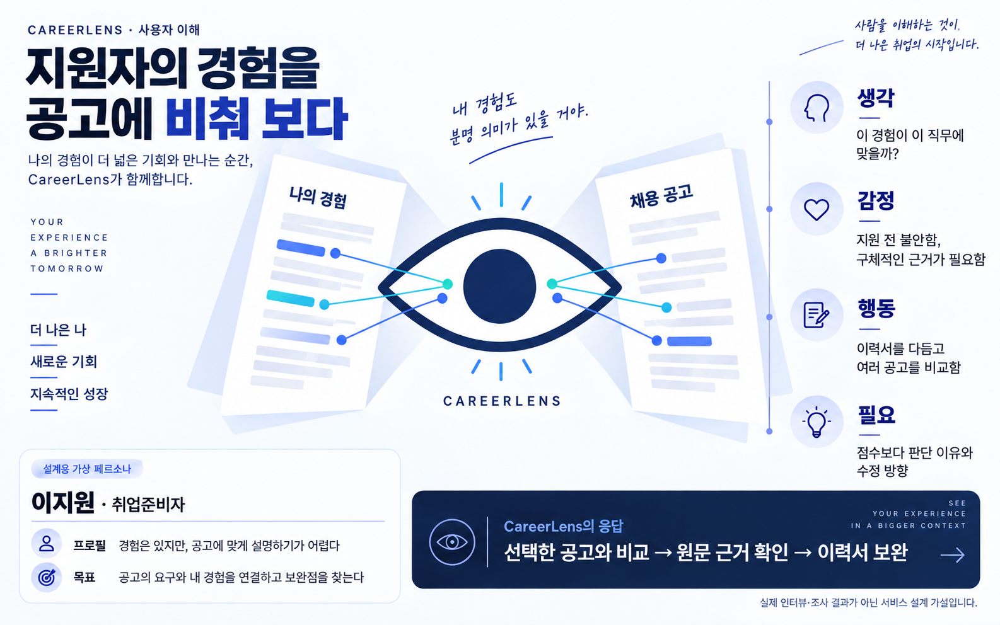

### 이해관계자 · 결과가 만들어진 과정을 설명하기

가상 페르소나 **김도윤 · 서비스 운영·평가 담당**은 처리 상태와 판단 근거를 확인하려는 사람입니다. 채용사의 실제 HR 권한이나 관리자 전용 전체 사용자 조회 기능을 가정하지 않습니다.

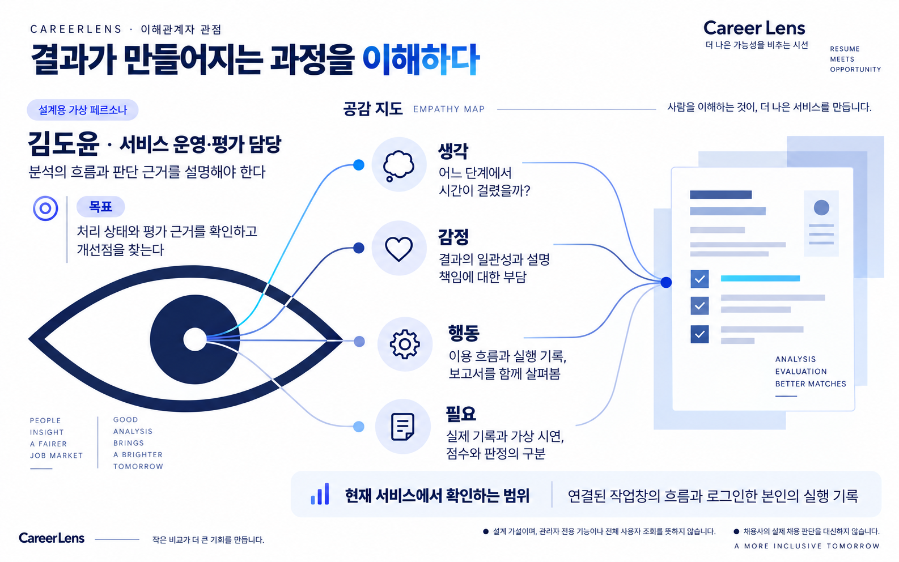

<a id="journeys"></a>

## 두 관점으로 읽는 사용자 여정

아래는 **2026-10-15 팀 배포 서비스**에서 촬영한 실제 화면을 단계별 질문과 연결한 안내입니다. 공개 가상 이력서와 교육용 모의공고를 사용했습니다. 앞의 눈 심벌 일러스트와 달리, 아래 서비스 화면은 AI로 생성한 UI가 아닙니다.

### 지원자는 무엇을 얻는가

이력서를 준비한 뒤 공고 하나를 선택하고, 평가 이유를 읽어 보완할 내용을 찾습니다.

**01. 비교할 경험을 준비한다**

로그인 후 이력서 본문을 준비합니다. 공개 가상 이력서로도 분석 과정을 체험할 수 있습니다.

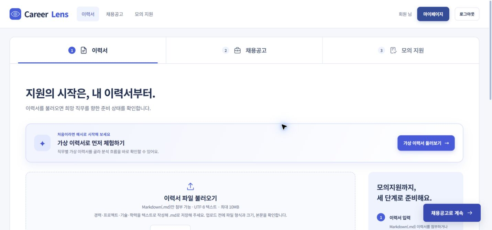

**02. 관심 직무를 정한다**

관심 있는 직무를 선택해 어떤 분야의 공고를 살펴볼지 정합니다. 선택한 이력서는 다음 단계로 이어집니다.

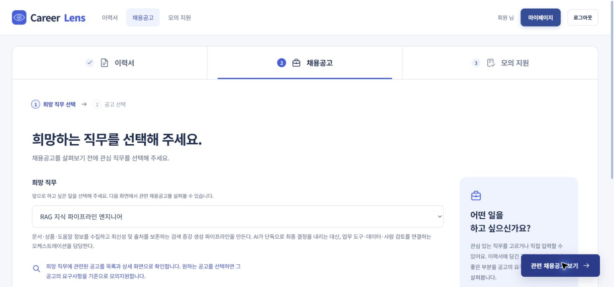

**03. 기준이 될 공고를 고른다**

희망 직무와 공고의 업무·지원 요건을 살펴보고, 이력서와 비교할 모의공고를 선택합니다.

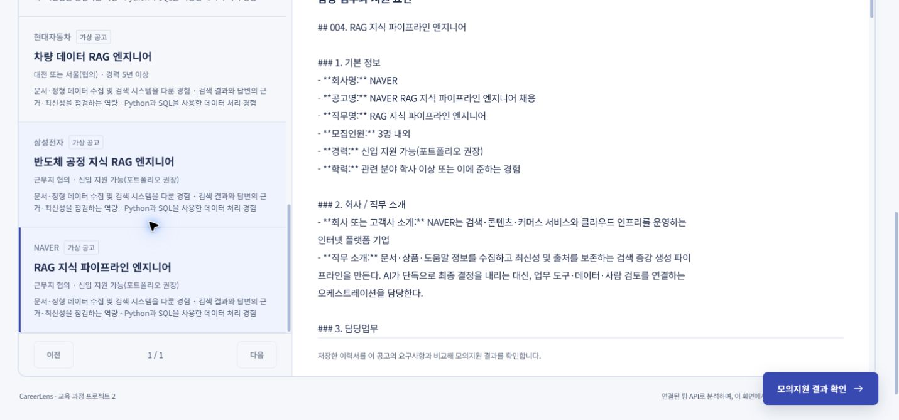

**04. 현재 처리 상태를 확인한다**

분석을 요청하면 처리 단계를 확인하며 기다립니다. 표시되는 진행률은 평가 점수와 다릅니다.

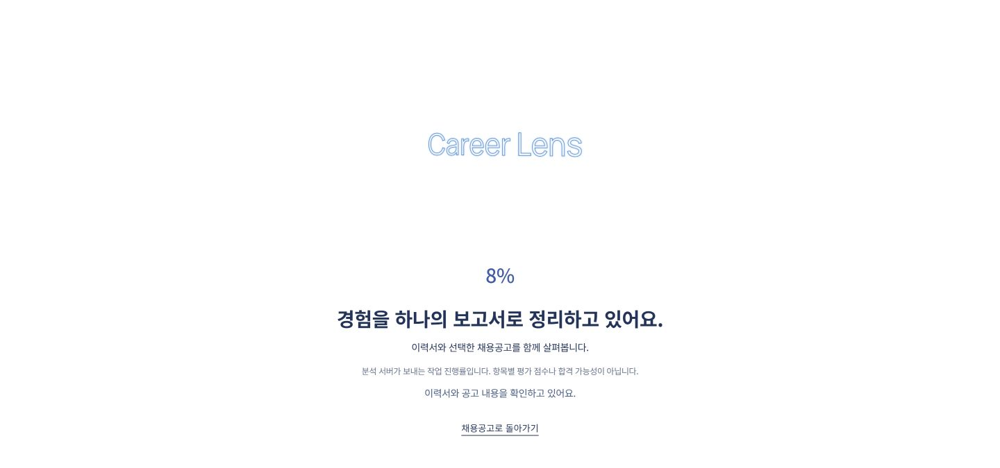

**05. 판단 이유를 읽고 보완한다**

네 평가 영역의 점수와 판정, 원문 근거와 보완 방향을 함께 읽습니다. 점수는 합격 확률이나 지원자 순위가 아닙니다.

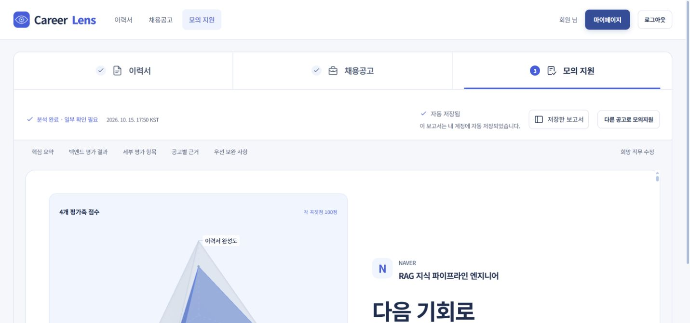

### 운영·평가 담당자는 어떻게 살펴보는가

처리 흐름과 저장된 기록을 함께 읽고, 결과를 설명할 수 있는 단서를 찾습니다.

**현재 확인 범위:** 대시보드의 ‘이 작업창 이용 흐름 새 창 열기’에서 연결한 창은 현재 작업의 흐름을 관찰합니다. 대시보드는 로그인한 본인의 실행 기록을 확인합니다. 관리자 전용 전체 사용자 조회나 채용사의 HR 판단 기능을 뜻하지 않습니다.

**01. 연결 방법과 시연을 구분한다**

작업창에서 이용 흐름 새 창을 열어 ‘원래 작업 창 연결됨’을 확인하면 실시간 관찰이 가능합니다. 아래 사진은 별도의 가상 이벤트 시연이며 실시간 분석 화면은 아닙니다.

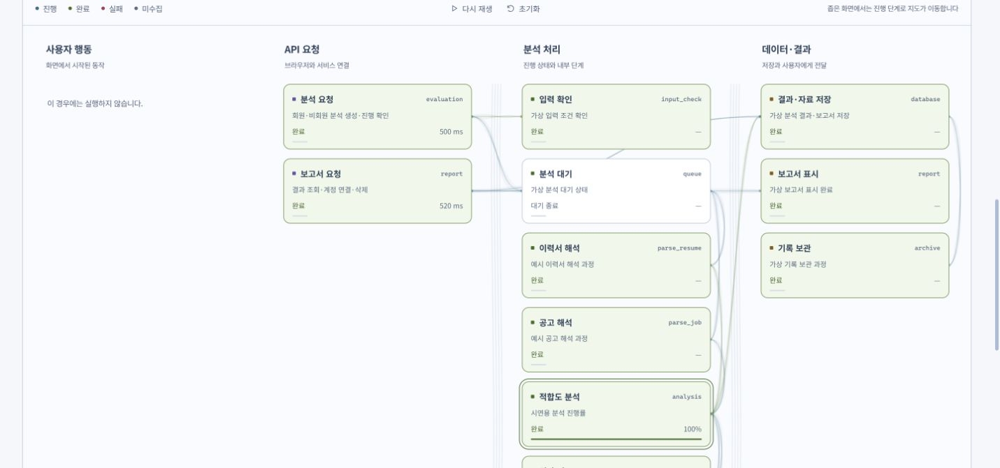

**02. 기록으로 범위를 좁힌다**

대시보드를 별도 창으로 열고 본인 실행의 상태와 단계·시간 등 기록된 정보를 확인합니다. 수집되지 않은 값은 추정하지 않습니다.

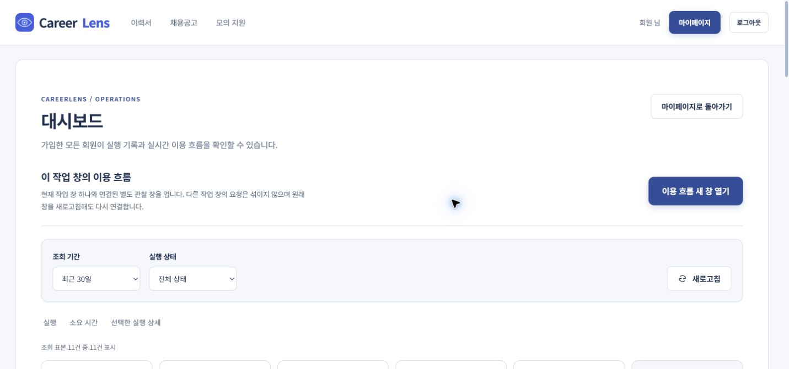

**03. 보고서와 근거를 대조한다**

검토 상태와 자격 판정, 숫자 점수를 나눠 읽고 결과의 이유와 원문 근거를 살펴봅니다.

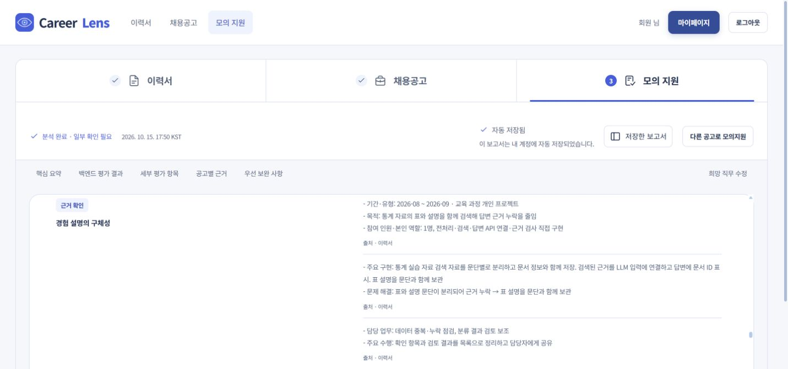


<a id="working-video"></a>

## 짧은 작동 영상

**실제 분석과 이용 흐름의 가상 시연을 서로 다른 영상으로 구분했습니다. 두 영상은 동일 실행에 연결된 실시간 기록이 아닙니다.** 실시간 관찰은 작업창의 **이 작업창 이용 흐름 새 창 열기**에서 연결하고 **원래 작업 창 연결됨**을 확인해 사용합니다. 주소를 직접 연 미연결 창과 구분합니다.

이번 자료에는 **실제 분석 중 실시간 이용 흐름까지 함께 움직이는 영상은 포함하지 못했습니다.** 정상 연결 상태는 확인했으며, 아래 이용 흐름 영상은 별도의 가상 이벤트 UI 시연입니다.

### 실제 분석 · 로딩에서 저장 보고서까지

공개 가상 이력서로 분석을 한 번 실행해 로딩과 최종 보고서를 기록했습니다. 실제 화면 40프레임을 약 12초로 구성하고 긴 대기 구간을 생략했습니다. 끊김 없는 화면 녹화나 처리 속도 측정 자료가 아닙니다.

[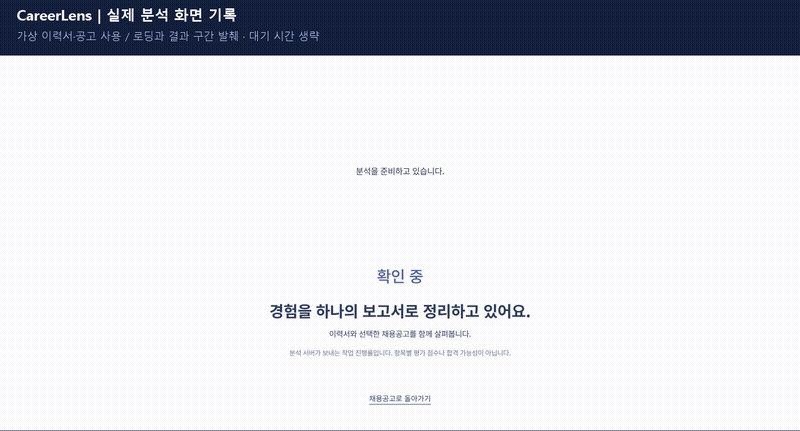](assets/journey/analysis-recording.mp4)

[실제 분석 영상 MP4 열기](assets/journey/analysis-recording.mp4)

### 이용 흐름 · 가상 이벤트 UI 시연

이용 흐름의 내장 시연 기능으로 단계·이벤트·상태가 바뀌는 모습을 담았습니다. 표시된 시간·로그·진행률은 가상 값이며 실제 분석 요청·서버 성능의 증거가 아닙니다.

[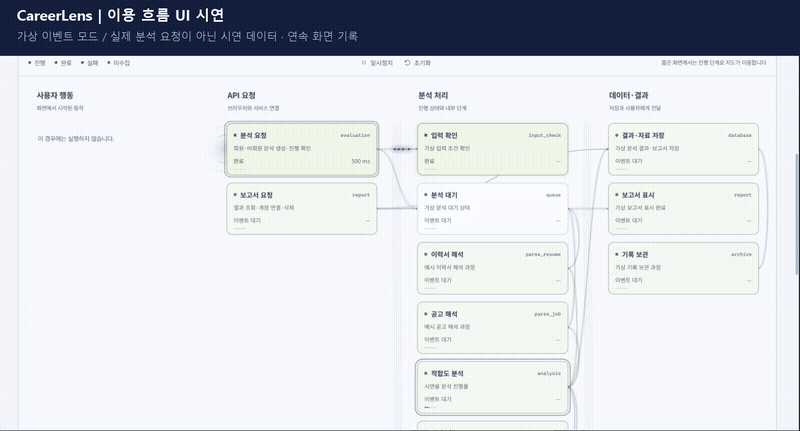](assets/journey/flow-demo.mp4)

[이용 흐름 시연 MP4 열기](assets/journey/flow-demo.mp4)

[로컬 보기용 HTML 원본](index.html) · [촬영과 편집 기준](docs/journey-media.md)

---

<a id="frontend"></a>

## 프론트엔드 · 화면과 분석 API 연결

Flask가 제공하는 HTML·CSS·JavaScript 화면을 분석 API와 연결하고, 비동기 요청과 상태 조회로 분석 작업을 이어갑니다.

### 사용한 서버와 도구

| 서버·도구 | 사용한 곳 | 선택한 장점 |
| --- | --- | --- |
| **Flask** | 화면·정적 파일과 공개 자료 제공 | Python 기반 분석 서비스와 연결하기 쉽고, 화면 제공과 간단한 웹 요청 처리를 한 앱에서 구성할 수 있음 |
| **HTML · CSS** | 페이지 구조, 보고서 배치, 상태·강조 표현 | 의미에 맞게 정보를 배치하고 화면 크기에 따라 목록과 본문 구성을 조절할 수 있음 |
| **JavaScript 모듈** | 이력서·공고·보고서 등 기능별 화면 동작 | 역할별 파일로 나눠 수정 범위를 관리하고 공통 동작을 재사용할 수 있음 |
| **Fetch API** | 서버에 자료 전달, 상태·결과 조회 | 별도 통신 라이브러리 없이 비동기 요청을 보내고, 화면 전체를 새로고침하지 않은 채 상태·결과를 갱신할 수 있음 |
| **Canvas 2D · SVG** | 분석 모션, 이용 흐름, 요청 시간 차트 | 처리 단계의 관계와 현재 상태를 시각적으로 구분할 수 있음 |
| **Three.js · WebGL** | 네 영역 점수를 나타내는 입체 도형 | 점수의 구성을 시각화하고, 지원되지 않는 환경에서는 SVG로 대체 |
| **BroadcastChannel** | 본 화면과 이용 흐름 팝업 사이의 이벤트 공유 | 같은 출처의 두 창에서 선택한 작업의 흐름을 함께 보여줄 수 있음 |
| **해시 기반 화면 전환** | `#/resume`, `#/result` 등 페이지 이동 | 하나의 앱 안에서 단계별 주소를 구분하고 화면 간 이동을 연결할 수 있음 |

Flask는 브라우저에 화면을 제공하는 서버입니다. 현재 통합 실행 구성에서는 **FastAPI에 Flask 앱을 연결**해 화면과 분석 API를 함께 제공합니다. [화면 서버 코드](https://github.com/encore-ai-campus/aio-02-p2-team3/blob/8b26c797231d744711749d2c456cd3dbb72afe8d/frontend/server.py) · [API 연결 코드](https://github.com/encore-ai-campus/aio-02-p2-team3/blob/8b26c797231d744711749d2c456cd3dbb72afe8d/frontend/src/shared/api/client.js)

### 새 창 연계와 인증 상태

이용 흐름 새 창에서 **`대시보드 열기`를 누르면 기존 이용 흐름 창을 유지하면서 대시보드를 별도 창으로 엽니다.** 로그인한 사용자는 인증 상태를 이어서 자신의 실행 기록을 확인하도록 연결했습니다. 브라우저 설정에 따라 새 탭으로 표시될 수 있습니다.

현재 연결은 동일 출처의 대시보드 주소를 `target="_blank"`, `rel="opener"`로 열고, 프론트엔드는 `sessionStorage`에 보관한 인증 토큰으로 세션을 확인합니다. 최초 주소 진입은 이메일 로그인으로 안내하고, 로그인 뒤에는 이력서 준비로 이동합니다. 이번 촬영에서는 인증된 이용 흐름 창의 대시보드 링크로 새 창을 열었을 때 재로그인 없이 회원 표시와 본인 실행 기록이 나타나는 범위를 확인했습니다. 장기간의 세션 유지나 전체 기능의 회귀 시험까지 확인한 결과는 아닙니다.

---

<a id="backend"></a>

## 백엔드 · 근거를 결과로 연결하기

백엔드는 **선택한 이력서 1개와 채용공고 1개**를 함께 읽고, 점수·판단 이유·원문 근거·보완 방향을 보고서로 만듭니다. 요청 접수와 오래 걸리는 분석을 분리해, 사용자는 처리 상태를 확인하면서 결과를 기다릴 수 있습니다.

### 팀 Render 배포의 실제 구성

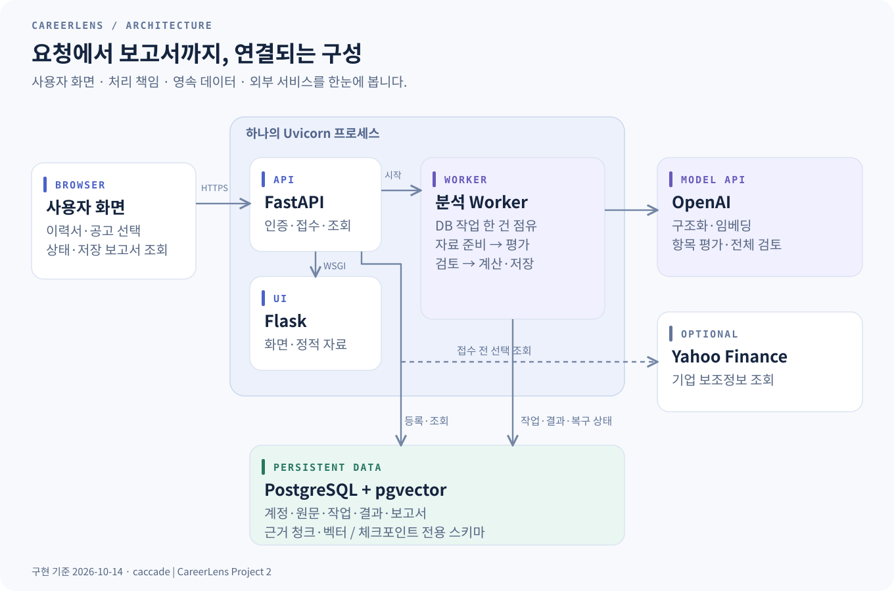

**하나의 Render 웹 프로세스에서 FastAPI·Flask·Worker가 함께 실행됩니다.** API는 분석 요청을 PostgreSQL에 등록하고, 같은 프로세스의 Worker가 대기 작업을 가져와 처리합니다. 화면과 API도 하나의 서비스 주소를 공유합니다.

| 구성 | 현재 역할 | 사용한 장점 |
| --- | --- | --- |
| **FastAPI · Uvicorn** | 인증, 자료 등록, 분석 접수·진행·결과 API | 요청 형식을 검사하고 비동기 작업과 API 문서를 함께 구성 |
| **Flask · WSGIMiddleware** | 화면·정적 자료 제공, FastAPI 아래에 화면 앱 연결 | 기존 Python 화면 서버를 통합 서비스에 연결 |
| **Evaluation Worker** | DB 대기 작업 점유, 상태 갱신, 분석·저장 | 접수 응답과 긴 분석 작업의 책임을 분리 |
| **LangGraph** | 병렬 평가, 조건부 재평가, 상태 병합 | 평가 순서와 분기·종료 조건을 코드로 명시 |
| **Render PostgreSQL · pgvector** | 계정·문서·결과·체크포인트·문장 벡터 | 분석 기록과 관련 근거 검색을 같은 데이터 기반에서 관리 |
| **OpenAI Responses API · Pydantic** | 문서 구조화와 항목별 해석 | 필요한 응답 필드를 지정하고 형식·범위를 검사 |
| **Yahoo Finance · yfinance** | 확인 가능한 기업의 보조정보 조회 | 공고·이력서를 해석할 기업 맥락을 보완 |

회원 인증은 이 저장소의 **FastAPI 인증 API + PostgreSQL 계정 + JWT** 경로를 사용합니다. 비밀번호는 해시로 저장하고, API는 로그인한 사용자가 소유한 자료인지 확인합니다.

이전 설계의 별도 Worker·Flask/Waitress·Supabase 구성과 현재 팀 배포는 구분합니다. 현재 실행 경계는 위 도해와 `blueprints/team3.yaml`을 기준으로 합니다.

### 구조와 패턴을 선택한 이유

CareerLens는 **코드가 실행 순서를 정하는 LangGraph 워크플로**입니다. 이력서와 공고의 비교라는 입력·목적이 고정되어 있어, 분석 단계와 조건 분기를 미리 정의할 수 있습니다. 네 평가 영역은 같은 입력을 공유하면서 독립적으로 평가한 뒤 결과를 모으므로 병렬화했습니다.

| 설계 판단 | 현재 선택과 이유 |
| --- | --- |
| 실행 제어 | 코드로 단계와 분기를 고정하고, LLM은 정해진 단계의 구조화·평가·검토에 사용 |
| 협업 패턴 | 순차 준비 + 네 영역 병렬 평가 + 전체 검토 + 문제 항목만 제한적으로 재평가 |
| 상태 공유 | 분석별 State와 항목 코드별 결과 병합, PostgreSQL 체크포인트 사용 |
| 처리 경계 | API가 접수·조회를 담당하고 Worker가 긴 분석을 처리하되, 현재는 같은 프로세스에서 실행 |
| 종료 기준 | 문제 항목이 없거나 전체 재평가 한 라운드 후 계산. 제한 시간·실패·취소는 별도 상태로 종료 |

기본 Worker는 사용자 분석을 한 건씩 처리합니다. 네 영역의 병렬 평가와 기본 네 개의 외부 요청 동시성 제한은 **한 분석 내부의 병렬성**입니다. 사용자 네 명의 분석을 동시에 처리한다는 의미는 아닙니다.

[상세 아키텍처와 실행 순서 보기](docs/architecture.md)

### 분석 요청이 보고서가 되는 과정

| 순서 | 서버에서 하는 일 | 남기는 정보 |
| --- | --- | --- |
| **1. 접수** | 로그인·이력서 소유권·공고·입력 형식·중복 요청 확인 | 분석 번호, 선택한 입력의 사본과 식별값 |
| **2. 준비** | Worker가 작업을 점유하고 문서 구조화·문장 분할·검색 준비 | 원문, 구조화된 경력·요건, 관련 문장 |
| **3. 평가** | 네 영역의 12개 항목 평가 | 점수, 판정, 이유, 인용, 보완 내용 |
| **4. 검토** | 원문 인용과 전체 결과 확인, 필요한 항목 재평가 | 문제 항목, 수정 결과, 남은 주의사항 |
| **5. 계산·저장** | 코드로 점수 집계, 항목·보고서·실행 기록 저장 | 종합 결과, Markdown 보고서, 운영 기록 |
| **6. 조회** | API가 본인 결과를 읽어 브라우저에 전달 | 보고서 화면, 저장 목록, 실행 상세 |

진행률 **100%만으로 결과를 공개하지 않습니다.** 실행 완료 상태와 보고서 준비·저장 여부를 함께 확인합니다.

<a id="agent"></a>

### 에이전트 · 4개 영역, 12개 항목, 7개 노드

**자료 파악 → 조건 판단 → 평가 실행 → 검증 → 필요한 수정 → 계산**을 하나의 분석 흐름으로 연결했습니다. 네 평가 영역은 같은 입력과 상태를 공유하고 병렬로 평가한 뒤, 결과를 모아 전체 검토를 진행합니다.

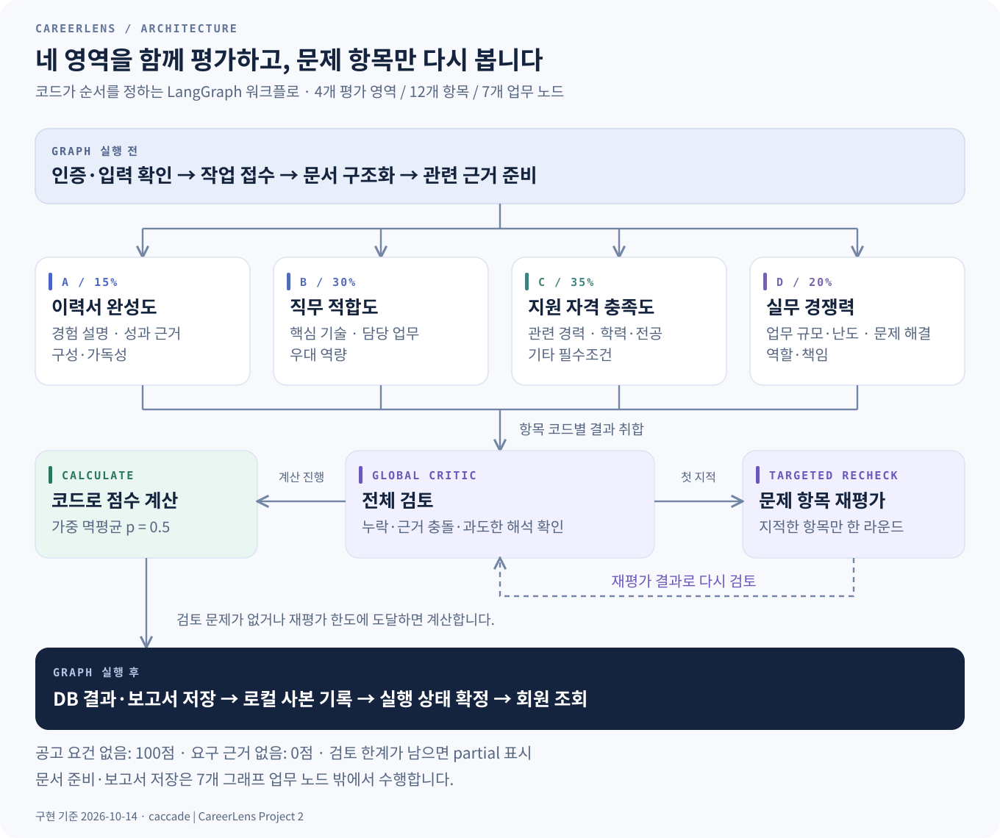

실행 순서는 코드로 정합니다. 문서 준비와 결과 저장을 연결하는 순차 처리, 네 영역의 병렬화, 전체 검토에 따른 제한된 재평가를 조합했습니다. 각 평가 노드는 같은 원문과 State를 공유하며, 모델이 다음 도구나 담당 노드를 자유롭게 선택하는 구조는 아닙니다.

| 노드 | 확인하는 내용 | 다음 처리 |
| --- | --- | --- |
| **① 이력서 완성도** | 경험 설명, 성과 근거, 구성과 가독성 | 영역의 3개 항목 결과 전달 |
| **② 직무 적합도** | 핵심 기술, 담당 업무, 우대 역량 | 영역의 3개 항목 결과 전달 |
| **③ 지원 자격 충족도** | 관련 경력, 학력·전공, 기타 필수조건 | 영역의 3개 항목 결과 전달 |
| **④ 실무 경쟁력** | 업무 규모·난도, 문제 해결, 역할·책임 | 영역의 3개 항목 결과 전달 |
| **⑤ 전체 검토** | 12개 항목의 누락·충돌·과도한 해석 | 재평가할 항목 선택 또는 계산 |
| **⑥ 문제 항목 재평가** | 전체 검토에서 지적한 항목만 다시 평가 | 전체 검토로 복귀 · 최대 1회 |
| **⑦ 점수 계산** | 검증한 숫자 점수와 고정 비중 집계 | 그래프 종료 후 보고서 생성·저장 |

문서 준비와 보고서 저장은 7개 노드의 앞뒤에서 수행합니다. 실제 외부 AI 요청의 동시 실행 수는 별도 제한하며, 기본값은 **4개**입니다.

**네 명의 팀원 모두 각 노드의 계산 방식에 대한 의견을 제안했고, 이를 평가 기준에 반영했습니다.** 무엇을 평가하고 어떤 원문 근거를 점수에 연결할지 함께 구체화했습니다.

### 도구는 언제 사용하나요?

| 필요한 처리 | 선택 조건과 동작 | 결과 확인 |
| --- | --- | --- |
| **문서 구조화** | 원문에서 경력·기술·공고 요건 추출 | 정해진 응답 형식과 인용 검사 |
| **자격 조건 계산** | 명시된 경력 기간·학력 등을 코드로 판단할 수 있을 때 | 기간 중복, 기준일, 최소 조건 확인 |
| **관련 문장 검색** | 근거가 필요한 항목에서 키워드 문맥과 벡터 검색 사용 | 선택 이력서·내용 해시 기준으로 근거 연결 |
| **AI 항목 평가** | 의미 해석이나 추가 판단이 필요한 경우 | 점수·판정·이유·원문 인용을 구조화해 수신 |
| **전체 검토** | 네 영역의 결과가 모인 뒤 | 문제 항목과 주의사항을 반환 |
| **기업 보조정보** | 등록된 종목 등으로 기업을 식별할 수 있을 때 | 출처·수집 시각·조회 가능 여부 기록 |

현재는 **Python 조건문과 LangGraph 분기가 필요한 함수를 선택**합니다. AI 응답은 Pydantic으로 지정한 형식을 사용하며, AI가 외부 도구를 직접 고르는 Function Calling은 구현되어 있지 않습니다.

외부 기업정보 조회 실패 시에는 기본 분석을 이어가도록 처리합니다. 다만 캐시의 날짜 자료형 변환 오류는 분석 접수를 막을 수 있어 보완이 필요합니다. 기업정보는 해석을 돕는 맥락이며 실제 지원자 수·경쟁자 이력서·지원자 순위를 제공하지 않습니다.

<details>
<summary>검색과 모델 요청의 구현 범위</summary>

- 이력서를 기본 600토큰 단위, 80토큰 중첩으로 나누고 원문 위치와 내용 해시를 연결합니다.
- 회원 분석은 문장 벡터를 PostgreSQL에 보관하고 `pgvector`로 관련 근거를 검색합니다. 기본 임베딩 모델은 `text-embedding-3-small`입니다.
- 키워드 기반 문맥을 먼저 준비하고, 코드 계산으로 결과가 정해지지 않은 검색 대상 항목에서 벡터 검색을 호출합니다. 비어 있지 않은 검색 결과가 있으면 그 근거를 사용합니다.
- 항목 요청에는 검색 근거뿐 아니라 **전체 이력서·공고 원문, 구조화한 자료, 기업 맥락**도 전달합니다. 검색이 원문 전체를 자동 요약·대체하는 구조는 아닙니다.
- 팀 Blueprint의 기본 분석 모델은 `gpt-6-luna`이며 환경 설정으로 변경할 수 있습니다.

</details>

### 오류를 확인하고 끝내는 기준

| 상황 | 처리 방식 |
| --- | --- |
| 비교할 공고 요건이 없음 | 해당 조건을 100점·충족으로 처리하고 이유 보관 |
| 요건은 있으나 이력서 근거가 없음 | 0점·미충족으로 처리하고 보완할 근거 안내 |
| 판단 신뢰도가 낮거나 추가 검토 대상 항목 | 독립 평가를 추가하고, 판정 또는 점수 차이가 크면 재검토 |
| 원문에 없는 인용·점수 근거 부족 | 보완 요청 후에도 문제가 남으면 해당 인용 제외, 0점 및 주의사항 기록 |
| 전체 검토에서 문제 발견 | 해당 항목만 최대 한 번 재평가하고 다시 검토 |
| 재평가 후에도 문제가 남음 | 숫자 결과와 함께 검토 한계를 표시해 완료 |
| 시간 초과·실행 오류·사용자 취소 | 실패·취소 등 종료 상태를 구분하고 진행 중 표시 종료 |

원문 검사는 **인용한 문장이 실제 제출 문서에 있는지** 확인합니다. 이력서에 적힌 경력 자체를 외부에서 사실 확인하는 기능은 아닙니다.

<details>
<summary>재검토와 재시도는 단계마다 다르게 제한합니다</summary>

| 범위 | 현재 코드 기준 |
| --- | --- |
| 항목 자체 검토 | AI 초안 이후 근거 중심 보완 평가 |
| 독립 평가 | 신뢰도 0.65 미만 또는 D1·D3에 적용; 판정 불일치 또는 15점 초과 차이 시 한 번 재검토 |
| 인용·근거 보완 | 검증 오류에 대해 한 번 보완; 계속 실패하면 0점·미충족과 주의사항 유지 |
| 전체 검토에 따른 재평가 | 문제 항목만 한 라운드 재평가 |
| LLM 통신 | 기본 요청 제한 90초, SDK 재시도 1회 |
| Worker 실행 | 기본 분석 제한 900초; 작업 점유 만료 후 복구는 최대 1회 |

전체 재평가 1회는 모든 모델 호출을 합쳐 한 번만 재시도한다는 뜻이 아닙니다. 사용자 취소나 작업 점유 상실이 확인되면 처리를 중단하며, 늦게 도착한 결과로 취소 상태를 완료로 바꾸지 않도록 관리합니다.

</details>

<a id="scoring"></a>

### 점수 · AI 해석과 코드 계산의 역할

AI는 일부 항목의 점수·판정·설명·인용을 제안합니다. 코드로 판단할 수 있는 자격 조건은 규칙을 적용하고, 최종 점수는 검증한 12개 항목을 정해진 비중으로 계산합니다.

| 평가 영역 | 전체 비중 | 세부 항목 · 영역 안의 비중 |
| --- | ---: | --- |
| **이력서 완성도** | **15%** | A1 경험 설명의 구체성 40% · A2 성과 근거의 명확성 35% · A3 구성과 가독성 25% |
| **직무 적합도** | **30%** | B1 핵심 기술 일치도 45% · B2 담당 업무 연관성 40% · B3 우대 역량 부합도 15% |
| **지원 자격 충족도** | **35%** | C1 관련 경력 충족도 60% · C2 학력·전공 충족도 25% · C3 기타 필수조건 충족도 15% |
| **실무 경쟁력** | **20%** | D1 업무 규모·난도 경쟁력 35% · D2 운영·문제 해결 경쟁력 35% · D3 역할·책임 수준 경쟁력 30% |

영역 안의 항목 점수를 먼저 합치고, 네 영역을 다시 합칩니다. 두 단계 모두 **가중 멱평균(p=0.5)**을 사용합니다.

```text
점수 = 100 × [ Σ(가중치 × √(개별 점수 ÷ 100)) ÷ Σ가중치 ]²

A1=100, A2=64, A3=36인 예시:
이력서 완성도 A = (0.40×√100 + 0.35×√64 + 0.25×√36)² = 68.89

A=68.89, B=81, C=100, D=64인 예시:
종합 = (0.15×√A + 0.30×√B + 0.35×√C + 0.20×√D)²
     = 81.812025 → 화면 정수 표시 82
```

위 숫자는 **산식 설명용 예시**입니다. 화면 반올림은 저장한 원본 점수를 바꾸지 않습니다. 계산 전에는 12개 항목이 모두 있는지, 점수가 0~100인지, 가중치가 유효한 양수인지 확인합니다.

| 함께 읽어야 하는 값 | 의미 |
| --- | --- |
| **종합·영역 점수** | 제출한 문서와 선택 공고를 평가한 숫자 결과 |
| **지원 자격 판정** | C1·C2·C3 중 하나라도 미충족이면 미충족; 종합 점수와 별도 표시 |
| **검토 상태** | 검토를 통과했는지, 확인할 한계가 남았는지 |
| **실행 상태** | 대기·분석 중·완료·실패·취소 등 처리 상태 |

실무 경쟁력은 **공고의 요구 수준과 문서에 적힌 경험을 비교**하는 항목입니다. 실제 경쟁자 순위나 합격 확률을 뜻하지 않습니다.

### 상태와 기억 · 무엇을 이어서 사용하나요?

분석 중에는 선택 원문·관련 문장·최신 항목 결과·문제 항목을 공유합니다. 네 영역의 결과는 **항목 코드별로 병합**하고, 재평가한 항목만 최신 값으로 교체합니다. 선택 당시 원문은 고정해 같은 입력을 기준으로 검토합니다.

| 구분 | 보관하는 내용 | 쓰임 |
| --- | --- | --- |
| **현재 분석의 State** | 원문, 구조화 자료, 근거, 항목 결과, 문제 항목, 계산값 | 노드 간 정보 전달과 조건 판단 |
| **입력 스냅샷** | 선택 당시 이력서·공고, 내용 해시, 기업정보, 설정 사본 | 어떤 자료로 평가했는지 확인 |
| **PostgreSQL 체크포인트** | 그래프의 중간 상태와 다음 작업 | 설정된 회원 분석의 중단 복구 |
| **저장 보고서·실행 기록** | 최종 결과, 근거, 검토 사항, 단계·시간·사용량 | 이전 결과 조회와 문제 추적 |

이 기억은 분석 한 건의 처리와 기록 재조회에 사용합니다. 개인 대화·취향을 장기간 학습하는 메모리 기능은 제공하지 않습니다.

<details>
<summary>공유 State의 13개 필드</summary>

| 필드 | 내용 |
| --- | --- |
| `run_id` | 분석 번호 |
| `resume`, `job` | 구조화한 이력서·공고 |
| `resume_text`, `job_text` | 선택 당시 원문 |
| `finance` | 기업 보조자료 |
| `chunks` | 관련 문장 후보 |
| `results` | 항목 코드별 최신 평가 결과 · 병합 reducer 적용 |
| `rechecks`, `affected` | 전체 재평가 횟수, 다시 볼 항목 |
| `scores`, `issues` | 계산 결과, 전체 검토 주의사항 |
| `as_of` | 고정한 경력 계산 기준일 |

`State`는 13개 키를 선언한 `TypedDict(total=False)`이며 모든 키를 필수로 요구하지 않습니다. `messages`, `tools_called`, `error_count`라는 별도 공유 필드는 없습니다. 관련 추적 정보는 AI 응답 기록·이벤트·주의사항·시도 기록에 나뉘어 저장됩니다.

</details>

### 중복 요청·복구·저장·접근 관리

| 관리 대상 | 현재 구현 |
| --- | --- |
| **중복 접수** | 같은 요청 식별값과 같은 입력은 같은 분석으로 처리 |
| **작업 점유** | Worker가 DB 작업을 점유하고 heartbeat로 점유 상태 갱신 |
| **복구** | 설정된 체크포인트와 남은 작업을 조회해 이어서 실행; 점유 만료 복구 횟수 제한 |
| **결과 영속 저장** | 회원 이력서 원문·항목 결과·Markdown 보고서·운영 기록을 PostgreSQL에 보관 |
| **파일 사본** | 서버 파일로도 보고서를 남기지만, 회원 보고서 조회·다운로드의 기준은 DB 저장본 |
| **본인 자료 접근** | 인증과 소유 사용자 확인을 거쳐 이력서·분석·보고서 조회 |

설정 사본은 보관하지만 복구 실행은 **현재 서버 환경 설정**을 사용합니다. 저장 당시 모델·프롬프트 설정을 자동으로 되돌리는 것까지 보장하지 않습니다.

### 대시보드에 연결되는 실행 기록

모델 요청의 단계·모델·응답 형식·요청 해시·시간·사용량과 분석 단계의 실행 기록을 저장합니다. 프론트엔드는 이를 실행 목록과 접을 수 있는 상세 영역으로 보여줍니다. 기록이 없는 값은 추정해서 채우지 않습니다.

현재 화면은 **로그인한 회원 본인의 기록을 조회**합니다. 별도의 관리자 API는 관리자 설정을 확인하지만, 화면의 대시보드 진입만으로 모든 사용자 기록을 볼 수 있는 구조는 아닙니다. 문서에 있던 관리자 전용 운영 기준과 현재 화면의 접근 범위는 구분해야 합니다.

<a id="deployment"></a>

### 배포 · 팀 Render 환경

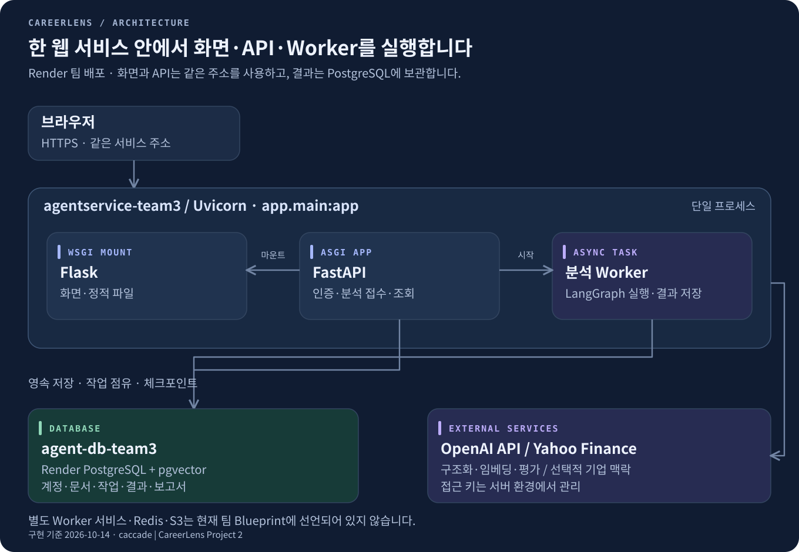

| 항목 | 팀 저장소의 설정 |
| --- | --- |
| **서비스 주소** | [agentservice-team3.onrender.com](https://agentservice-team3.onrender.com/) |
| **배포 기준 파일** | [`blueprints/team3.yaml`](https://github.com/encore-ai-campus/aio-02-p2-team3/blob/8b26c797231d744711749d2c456cd3dbb72afe8d/blueprints/team3.yaml) |
| **Render 프로젝트 / 환경** | `aio2-team3` / `production` |
| **웹 서비스 / DB** | `agentservice-team3` / `agent-db-team3` |
| **Python** | 3.13 · `.python-version` |
| **설치** | `pip install -r requirements.txt` |
| **실행** | `uvicorn app.main:app --host 0.0.0.0 --port $PORT` |
| **상태 확인** | `/healthz`는 웹 프로세스 생존 확인, `/health`는 DB 연결 확인 |
| **API 문서** | `/docs` |

팀 Blueprint는 DB의 내부 연결 주소를 `DATABASE_URL`로 전달하고 JWT 비밀키를 생성합니다. OpenAI 키와 허용 출처는 배포 환경에서 설정합니다. 서비스 키를 README나 브라우저 코드에 넣지 않습니다.

Render 구성은 Python 웹 서버, 내부 분석 Worker, PostgreSQL 연결을 한 배포 구성으로 관리합니다. 현재 코드에서 확인되는 통합 방식이며, Vercel에서 옮길 당시의 구체적인 장애 원인은 이 설정만으로 단정하지 않습니다.

<details>
<summary>배포 파일과 선택 기능을 구분하는 기준</summary>

- **팀 배포:** `blueprints/team3.yaml`을 기준으로 합니다. 루트의 `render.yaml`은 독립 워크스페이스용 대안이므로 팀 서비스 이름·주소와 혼용하지 않습니다.
- **통합 화면 서버:** `app/main.py`가 Flask를 직접 마운트하므로 별도 `BACKEND_URL` 프록시 경로가 필요하지 않습니다.
- **회원 저장소:** PostgreSQL 연결, 스키마 및 체크포인트 준비가 필요합니다. 준비 절차는 [`docs/backend-implementation.md`](https://github.com/encore-ai-campus/aio-02-p2-team3/blob/8b26c797231d744711749d2c456cd3dbb72afe8d/docs/backend-implementation.md)에 있습니다.
- **선택적 비회원 모듈:** 저장소에는 Flask·SQLite·스레드 풀을 사용하는 별도 비회원 엔진도 있습니다. 현재 팀 통합 진입점은 이 실분석 경로를 비활성화합니다. 이를 활성화하더라도 회원용 PostgreSQL 체크포인트를 쓰지 않으며, 계정 연결만으로 결과가 PostgreSQL로 이전되지 않습니다.

</details>

### 현재 한계와 다음 과제

| 항목 | 현재 구현과 보완할 내용 |
| --- | --- |
| **입력량 관리** | 회원 이력서는 기본 20,000토큰 제한을 검사합니다. 각 모델 응답은 최대 8,000토큰이며, 전체 입력·출력을 합친 예산 검사나 자동 요약은 아직 없습니다. |
| **완료 처리** | DB 결과·보고서 저장 뒤 부가 파일 기록 실패가 실행 실패로 이어질 수 있습니다. 사용자 결과 확정과 부가 기록의 실패 경계를 분리할 필요가 있습니다. |
| **복구 재현성** | 입력·설정 사본을 보관합니다. 재실행 시 저장한 모델·프롬프트 설정을 그대로 복원하는 정책은 보완이 필요합니다. |
| **비회원 연결** | 공고 탐색은 가능하지만 팀 통합 구성의 비회원 분석·인증 후 결과 연결은 별도 연동 과제입니다. |
| **운영 안정성** | 기업정보 캐시의 날짜 자료형 처리와 신규 DB 초기화 스크립트의 행 접근 오류가 재현되어 보완이 필요합니다. |
| **대시보드 접근 기준** | 현재 본인 기록을 조회합니다. 관리자 전용 운영 기준과 화면·API 권한을 맞추는 작업은 구분해 관리해야 합니다. |

자동 요약, AI의 직접 도구 선택, 실제 채용 성공률 측정은 현재 구현 기능으로 소개하지 않습니다.

---

<a id="retrospectives"></a>

## 팀원 회고

### 성관현 · PM

의견 조율과 역할 배분, 산출물 관리를 맡으며 팀원들의 판단 배경과 작업 속도를 이해하는 중요성을 배웠습니다.  
안정성과 기능 확장 사이에서 방향을 조율했지만, 일부 세부 구조가 프로젝트 목적과 충분히 연결되지 못한 점은 아쉬웠습니다.  
다음에는 기능의 목적·필요성·우선순위를 기록하고, 팀원의 작업 부담과 진행 속도를 살피며 역할과 일정을 정하겠습니다.

### 백승주 · Backend/Data Engineer

데이터베이스 설계·연동과 백엔드 데이터 처리, 팀 일정 관리를 맡고 프로젝트 문서 6종과 가상 이력서 자료를 정리했습니다.  
에이전트 흐름과 평가 기준을 문서화하며 프로젝트 구조와 판단 기준을 구체화하는 경험을 쌓았습니다.  
다음에는 필요한 일을 먼저 제안하고, 백엔드 작업과 일정 관리에도 더 주도적으로 참여하겠습니다.

### 노지훈 · 백엔드

AI 에이전트 설계부터 백엔드·DB·배포까지 서비스 개발 전반을 경험하고, 통합 과정에서 발생하는 문제를 해결했습니다.  
기능 구현과 함께 팀원 간 협업과 일정 관리가 서비스 완성도에 중요하다는 점을 체감했습니다.  
다음에는 초기 설계와 역할 분담을 더 명확히 하고, 성능 최적화와 테스트 자동화에 집중하겠습니다.

### 신영석 · 프론트엔드

AI와 외부 전문가의 조언을 적극 활용해 프론트엔드 구현에 필요한 기술과 도구를 익히고, 이를 실제 서비스 화면과 사용자 흐름으로 연결했습니다.  
다른 팀의 자료와 구현 사례를 비교해 우리 프로젝트에 필요한 요소를 선별·보완하고, 작업 내용을 공유하며 서비스 구성과 협업에 기여했습니다.  
제한된 기간에도 학습과 구현을 병행하며 새로운 역할을 수행하는 실행력을 키웠고, 앞으로는 체계적인 작업 관리로 서비스 완성도를 더욱 높이겠습니다.

---

<a id="references"></a>

## 참고 자료와 구현 근거

- [현행 아키텍처와 실행 흐름](docs/architecture.md): 전체 구성·평가 분기·State·저장·종료 조건·배포 경계
- [팀 1~3일차 작업 기록](https://docs.google.com/document/d/1m4Od4s3NTmhs-xs_vCmlDW5nDuRy3vrPIG8vFzWLg-s/edit?tab=t.b6qs2piep0mg) · [팀원 GitHub 주소 기록](https://docs.google.com/document/d/1m4Od4s3NTmhs-xs_vCmlDW5nDuRy3vrPIG8vFzWLg-s/edit?tab=t.whmuc795y56q)

- [팀 에이전트 아키텍처 설계서](https://yleeylee.notion.site/CareerLens-d5d2b0d658a6822aa5478173218a475b): 업무 구성, 평가 흐름, 조건별 처리, 계산, 공유 상태, 기억·복구, 입력량 관리, 중복 방지, 접근 경계
- [프로젝트 팀 문서](https://yleeylee.notion.site/CareerLens-3f62b0d658a6804885d1c5fbfcc764f1): 프로젝트 소개와 팀 배포 주소
- [기획서](https://yleeylee.notion.site/c6c2b0d658a683f4b85b012fd8cb1753) · [요구사항](https://yleeylee.notion.site/fb62b0d658a68254835b015794d50006)
- [화면설계서 v3](https://github.com/encore-ai-campus/aio-02-p2-team3/blob/8b26c797231d744711749d2c456cd3dbb72afe8d/frontend/docs/design/v3/CareerLens_프로젝트2_화면설계서_v3_20261013.pptx)

<details>
<summary>설명별 코드 위치 · 확인 기준 2026-10-15 / 8b26c79</summary>

| 확인한 내용 | 코드 |
| --- | --- |
| 팀 Render 배포와 통합 프로세스 | [`blueprints/team3.yaml`](https://github.com/encore-ai-campus/aio-02-p2-team3/blob/8b26c797231d744711749d2c456cd3dbb72afe8d/blueprints/team3.yaml), [`app/main.py`](https://github.com/encore-ai-campus/aio-02-p2-team3/blob/8b26c797231d744711749d2c456cd3dbb72afe8d/app/main.py) |
| 화면 서버·분석 연결 | [`frontend/server.py`](https://github.com/encore-ai-campus/aio-02-p2-team3/blob/8b26c797231d744711749d2c456cd3dbb72afe8d/frontend/server.py), [`backend-adapter.js`](https://github.com/encore-ai-campus/aio-02-p2-team3/blob/8b26c797231d744711749d2c456cd3dbb72afe8d/frontend/src/shared/api/backend-adapter.js) |
| 인증·소유권·분석 접수·대시보드 API | [`app/api/v1/routes/api.py`](https://github.com/encore-ai-campus/aio-02-p2-team3/blob/8b26c797231d744711749d2c456cd3dbb72afe8d/app/api/v1/routes/api.py) |
| 7개 노드·State·검색·검토 | [`app/agent/graphs/matching.py`](https://github.com/encore-ai-campus/aio-02-p2-team3/blob/8b26c797231d744711749d2c456cd3dbb72afe8d/app/agent/graphs/matching.py) |
| 평가 항목과 비중·점수 계산 | [`rubric.py`](https://github.com/encore-ai-campus/aio-02-p2-team3/blob/8b26c797231d744711749d2c456cd3dbb72afe8d/app/modules/analysis/scoring/rubric.py), [`calculator.py`](https://github.com/encore-ai-campus/aio-02-p2-team3/blob/8b26c797231d744711749d2c456cd3dbb72afe8d/app/modules/analysis/scoring/calculator.py) |
| 준비·체크포인트·최종 저장 | [`app/application/evaluation.py`](https://github.com/encore-ai-campus/aio-02-p2-team3/blob/8b26c797231d744711749d2c456cd3dbb72afe8d/app/application/evaluation.py), [`workers/evaluation.py`](https://github.com/encore-ai-campus/aio-02-p2-team3/blob/8b26c797231d744711749d2c456cd3dbb72afe8d/workers/evaluation.py) |
| 모델 형식·사용량·기본 제한 | [`app/integrations/llm/client.py`](https://github.com/encore-ai-campus/aio-02-p2-team3/blob/8b26c797231d744711749d2c456cd3dbb72afe8d/app/integrations/llm/client.py), [`app/core/config.py`](https://github.com/encore-ai-campus/aio-02-p2-team3/blob/8b26c797231d744711749d2c456cd3dbb72afe8d/app/core/config.py) |
| PostgreSQL 저장·배포 준비 | [`docs/backend-implementation.md`](https://github.com/encore-ai-campus/aio-02-p2-team3/blob/8b26c797231d744711749d2c456cd3dbb72afe8d/docs/backend-implementation.md), [`app/infrastructure/database/postgres.py`](https://github.com/encore-ai-campus/aio-02-p2-team3/blob/8b26c797231d744711749d2c456cd3dbb72afe8d/app/infrastructure/database/postgres.py) |

설계 문서와 차이가 있는 부분은 위 코드와 **팀 Blueprint**를 우선했습니다. Notion 원본 이미지는 설계 참고 자료로 구분했습니다. 코드에 남아 있는 SQL 설계의 테이블·정책 개수를 곧바로 팀 운영 DB의 적용·검증 결과로 제시하지 않습니다.

팀 문서의 **시험·품질 검증 및 하위 문서는 참고 대상에서 제외**했습니다. 성능 수치나 검증 통과율은 추정해 넣지 않았습니다. [PlanEat README](https://github.com/DongJunee/2026_aio2_p2_PlanEat_Backend/blob/main/README.md)는 소개·기능·기술을 설명하는 문서 구성만 참고했습니다.

</details>
