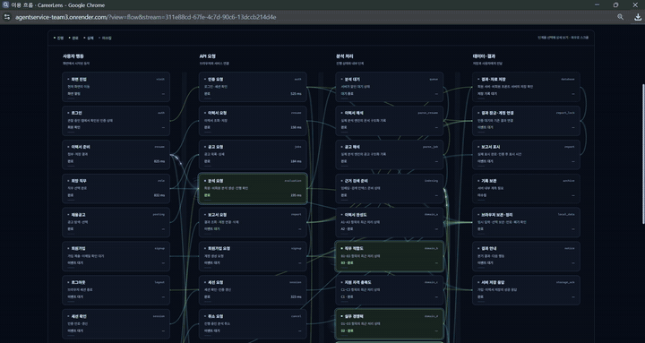

# CareerLens

### AI-Powered Resume & Job Matching Platform

CareerLens compares a resume with a selected job posting and generates an evidence-based fit report. It evaluates **12 criteria across four categories** using a **LangGraph parallel evaluation pipeline**, then validates findings and selectively re-evaluates items that need further review.

**Team project · AI Systems Architecture / Backend Integration / Deployment**

[**Live Demo**](https://agentservice-team3.onrender.com/) · [**Technical Architecture**](docs/architecture.md) · [**Project Portfolio**](https://github.com/931njhthe-star)

## Demo

> The demo uses sample resumes and simulated job postings. Scores represent an assessment of submitted materials, not hiring probabilities or candidate rankings.

## Key Features

- **Resume-to-job analysis:** compares the applicant's stated experience with selected job requirements and provides supporting evidence and improvement suggestions.
- **Parallel AI evaluation:** evaluates resume quality, job fit, eligibility, and practical competitiveness across **12 criteria** in four parallel branches.
- **Validation and targeted re-evaluation:** checks cited evidence and revisits affected items instead of blindly rerunning every assessment.
- **Asynchronous execution:** tracks analysis status, saves reports, and supports retrieval of previous analyses.
- **Monitoring:** displays execution stages and recorded timing/usage information for the signed-in user's runs.

## AI Evaluation Architecture

The LangGraph workflow runs four evaluation branches in parallel, merges results by criterion, applies evidence checks, and performs limited conditional re-evaluation before calculating the final report.

## My Contributions

**AI Systems Architect & Technical Lead**

- Designed the **four-way parallel LangGraph evaluation architecture** and conditional review workflow.
- Defined the **12-criterion assessment framework** and weighted scoring approach.
- Integrated AI analysis with **FastAPI, PostgreSQL**, and asynchronous processing/status tracking.
- Connected evaluation results and execution records to the service and monitoring interface.
- Supported end-to-end integration, Render deployment, and troubleshooting.

## Tech Stack

| Layer | Technologies |
| --- | --- |
| AI orchestration | Python, LangGraph, LLM APIs |
| Backend | FastAPI, asynchronous processing |
| Database | PostgreSQL |
| Frontend | Flask, HTML, CSS, JavaScript |
| Deployment | Render |

## Architecture & Implementation Details

For deeper technical review, see the [architecture document](docs/architecture.md), [backend implementation](docs/backend-implementation.md), and [project requirements and design references](https://github.com/931njhthe-star/CareerLens-fullstack/tree/main/docs).

**Implementation notes:** The current team deployment uses sample job postings for demonstration. Report scores are evidence-based document assessments rather than predictions of real-world hiring outcomes. Recovery and monitoring capabilities are limited to the supported deployment and recorded execution data.

---

**[Open Live Demo](https://agentservice-team3.onrender.com/)** · **[View Source Repository](https://github.com/931njhthe-star/CareerLens-fullstack)**
