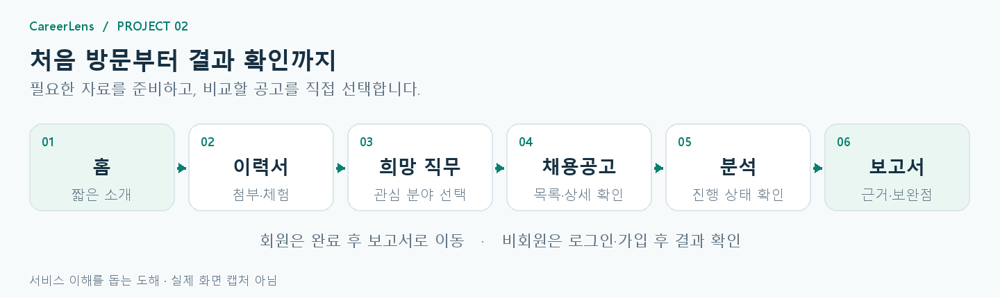
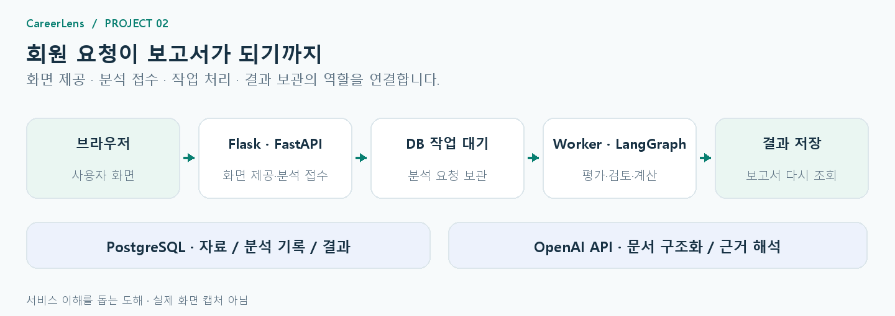
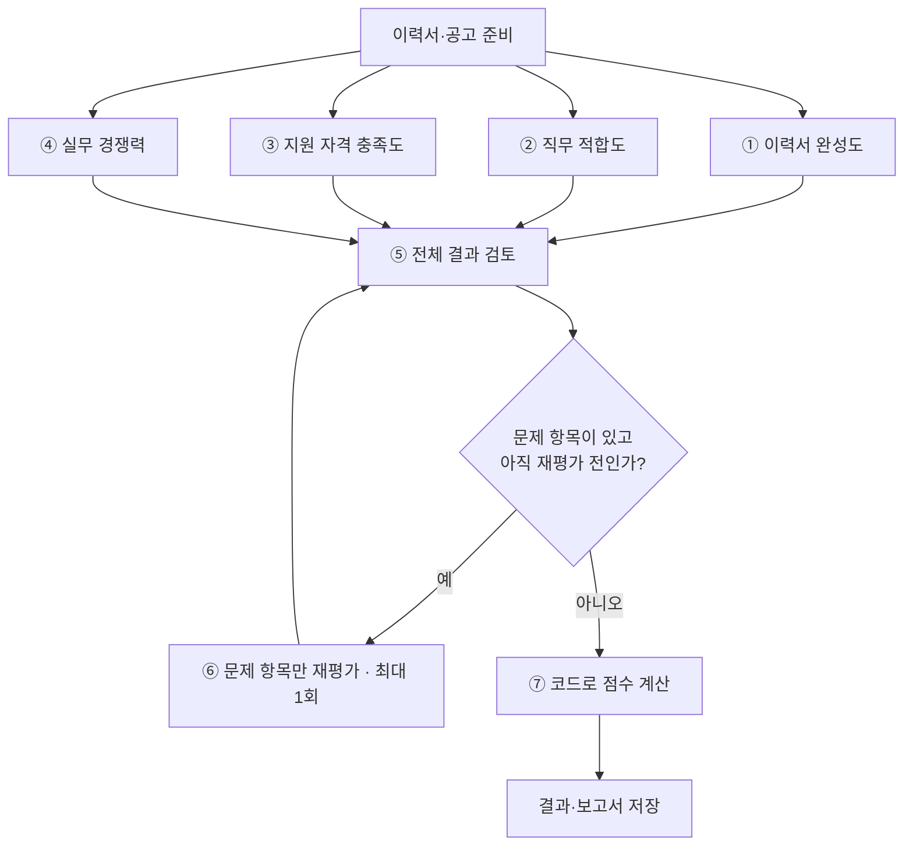

# CareerLens

### 내 경험을 공고에 비춰 보고, 다음 보완점을 찾다

**CareerLens는 이력서와 사용자가 선택한 채용공고를 비교해, 평가 이유·원문 근거·보완 방향을 함께 보여주는 AI 모의지원 서비스입니다.**

프로젝트 2 · 프론트엔드와 백엔드를 연결한 통합 서비스

[서비스 소개](#service) · [프론트엔드](#frontend) · [백엔드](#backend) · [참고 자료](#references)

<a id="service"></a>

## 우리가 해결하려는 문제

이력서를 작성해도 특정 공고에서 어떤 경험을 중요하게 보는지, 내 경험을 충분히 설명했는지 판단하기는 어렵습니다. CareerLens는 사용자가 직접 선택한 공고를 기준으로 이력서를 읽고, 수정할 내용을 찾도록 돕습니다.

| 사용자의 고민 | CareerLens의 도움 |
| --- | --- |
| 어떤 공고를 기준으로 준비할까? | 희망 직무에 맞는 공고를 탐색하고 직접 선택 |
| 내 경험이 공고의 요구와 연결될까? | 네 가지 평가 영역과 항목별 판단 이유 제공 |
| 결과를 보고 무엇을 고치면 될까? | 원문 근거와 추가로 설명할 내용 안내 |
| 이전에 확인한 결과는 어디에 있을까? | 저장된 보고서 목록에서 다시 확인 |

현재 공고는 교육·시연용 모의자료입니다. 점수는 제출한 문서의 근거를 검토한 결과이며, 합격 확률이나 지원자 순위를 뜻하지 않습니다.

## 함께 만든 사람들

| 이름 | 역할 |
| --- | --- |
| **노지훈** | Core Backend Engineer |
| **신영석** | Frontend Software Architect |
| **백승주** | Backend/Data Engineer |
| **성관현** | Project Manager |

## 한눈에 보는 이용 순서



회원과 비회원 모두 **이력서 준비 → 희망 직무 선택 → 채용공고 확인** 순서로 이용합니다. 비회원은 결과를 열 때 로그인 또는 회원가입으로 이어집니다.

아래 이미지는 기능과 흐름을 이해하기 위한 간단한 도해입니다. 실제 화면 캡처와는 구분됩니다.

---

<a id="frontend"></a>

## 프론트엔드 · 사용자가 이해하기 쉬운 화면

**자료를 준비하고, 공고를 선택하고, 결과를 읽는 과정이 자연스럽게 이어지도록 구성했습니다.** 각 화면에서 현재 상태와 다음 행동을 함께 안내합니다.

### 사용한 서버와 도구

| 서버·도구 | 사용한 곳 | 선택한 장점 |
| --- | --- | --- |
| **Flask** | 화면·정적 파일과 공개 자료 제공 | Python 기반 분석 서비스와 연결하기 쉽고, 화면 제공과 간단한 웹 요청 처리를 한 앱에서 구성할 수 있음 |
| **HTML · CSS** | 페이지 구조, 보고서 배치, 상태·강조 표현 | 의미에 맞게 정보를 배치하고 화면 크기에 따라 목록과 본문 구성을 조절할 수 있음 |
| **JavaScript 모듈** | 이력서·공고·보고서 등 기능별 화면 동작 | 역할별 파일로 나눠 수정 범위를 관리하고 공통 동작을 재사용할 수 있음 |
| **Fetch API** | 서버에 자료 전달, 상태·결과 조회 | 브라우저의 기본 기능으로 요청·응답을 다루고 서버가 제공한 상태를 화면에 반영할 수 있음 |
| **해시 기반 화면 전환** | `#/resume`, `#/result` 등 페이지 이동 | 하나의 앱 안에서 단계별 주소를 구분하고 화면 간 이동을 연결할 수 있음 |

Flask는 브라우저에 화면을 제공하는 서버입니다. 현재 통합 실행 구성에서는 **FastAPI에 Flask 앱을 연결**해 화면과 분석 API를 함께 제공합니다. [화면 서버 코드](https://github.com/931njhthe-star/CareerLens-fullstack/blob/79c3b4b9253629ab6589f512b145a93595834f1c/frontend/server.py) · [API 연결 코드](https://github.com/931njhthe-star/CareerLens-fullstack/blob/79c3b4b9253629ab6589f512b145a93595834f1c/frontend/src/shared/api/client.js)

### 01. 홈 · 짧은 소개로 시작

| 화면 요소 | 기능 | 다음 이동 |
| --- | --- | --- |
| 소개 애니메이션 | 서비스의 첫인상을 전달하고 자동으로 다음 화면 안내 | 이력서 첨부 페이지 |
| 건너뛰기 | 소개를 기다리지 않고 시작 | 이력서 첨부 페이지 |
| 오른쪽 상단 로그인 | 원하는 시점에 회원 이용 선택 | 로그인·회원가입 |

로그인하지 않아도 이력서 첨부와 공고 탐색을 시작할 수 있습니다.

### 02. 이력서 · 비교할 자료 준비

| 화면 요소 | 기능 | 사용자가 확인하는 결과 |
| --- | --- | --- |
| 파일 첨부 | UTF-8 Markdown(`.md`) 이력서 선택 | 파일명과 첨부 상태 |
| 본문 편집 · 회원 | 직접 입력하거나 불러온 내용 수정 | 분석에 사용할 이력서 본문 |
| 가상 이력서 체험 · 회원 | 준비된 예시 이력서 선택 | 내 문서 없이도 서비스 체험 |
| 다음 단계 버튼 | 준비한 이력서로 이동 | 희망 직무 선택 화면 |

다음 단계 버튼은 회원에게 **`채용공고로 계속`**, 비회원에게 **`첨부한 이력서로 계속`**으로 표시됩니다. 파일 형식·용량 등의 조건을 충족하지 않으면 이유를 안내합니다.

### 03. 희망 직무 · 관심 공고의 범위 선택

| 화면 요소 | 기능 | 다음 이동 |
| --- | --- | --- |
| 희망 직무 목록·직접 입력 | 관심 직무 선택 또는 입력 | 선택한 직무 기준으로 탐색 준비 |
| 첨부 이력서 안내 | 사용할 이력서 확인 | 필요하면 이전 화면에서 수정 |
| `관련 채용공고 보기` | 직무에 맞는 공고 조회 | 공고 목록·상세 화면 |

### 04. 채용공고 · 목록과 상세를 함께 확인

| 화면 요소 | 기능 | 사용자가 확인하는 결과 |
| --- | --- | --- |
| 공고 목록 | 회사·직무·경력·기술 등을 보고 선택 | 선택한 공고의 상세 내용 |
| 공고 상세 | 담당 업무와 지원 요건 확인 | 이력서와 비교할 조건 |
| 탐색 범위·이전·다음 | 공고를 바꾸며 비교 | 희망하는 분석 대상 선택 |
| `모의지원 결과 확인` | 선택한 이력서와 공고로 분석 시작 | 분석 진행 화면과 이용 흐름 팝업 |

### 05. 분석 진행 · 현재 상태를 함께 안내


**`모의지원 결과 확인`을 누르면 분석이 시작되고, 이용 흐름 페이지가 별도 팝업으로 열립니다.**

| 화면 | 보여주는 정보 | 구성 의도 |
| --- | --- | --- |
| 분석 진행 화면 | 분석 중 모션, 서버가 전달한 진행률·현재 단계 | 사용자가 기다리는 이유와 현재 상태를 이해 |
| 이용 흐름 팝업 | 연결된 작업의 행동·요청·응답·처리 단계 | 사용자의 동작이 처리 과정으로 이어지는 모습을 확인 |
| 완료 전환 | 분석과 저장이 끝난 상태 | 회원은 보고서로, 비회원은 인증 안내로 이동 |

진행률은 분석 처리 상태를 뜻합니다. 서버에서 값이 오지 않았을 때는 임의 숫자를 채우지 않고 확인 중인 상태로 안내합니다.

**비회원의 결과 확인:** 분석한 결과는 임시로 보관하고, 로그인·회원가입 후 계정에 연결해 엽니다. 인증 전에 실제 보고서 본문과 점수를 공개하지 않습니다.

### 06. 보고서 · 이유와 근거를 읽고 보완점 찾기


| 화면 영역 | 기능 | 사용자가 얻는 정보 |
| --- | --- | --- |
| 공고·핵심 요약 | 어떤 공고에 대한 결과인지 안내 | 보고서의 대상과 핵심 의견 |
| 네 가지 평가 영역 | 이력서 완성도·직무 적합도·지원 자격 충족도·실무 경쟁력 표시 | 어느 부분을 더 살펴볼지 판단 |
| 세부 항목 | 점수와 이유, 원문 인용, 보완 내용 연결 | 내 경험이 어떻게 반영되었는지 확인 |
| 저장 보고서 사이드바 | 이전 결과 선택 | 재분석 없이 기존 보고서 다시 읽기 |

현재 열어둔 보고서는 **초록색 테두리와 ‘현재 보고서’ 표시**로 구분합니다. 목록의 순서와 읽던 위치를 유지해 다른 결과를 확인하고 돌아오기 쉽도록 구성했습니다.

### 07. 마이페이지 · 저장된 결과 관리

| 화면 요소 | 기능 | 사용자가 확인하는 결과 |
| --- | --- | --- |
| 계정 정보 | 이름·이메일 표시 | 현재 이용 중인 계정 |
| 보고서 목록·검색·필터 | 저장한 분석 조회 | 다시 읽을 보고서 찾기 |
| 더 불러오기·삭제 | 이전 기록 추가 조회, 삭제 가능한 기록 관리 | 필요한 결과 정리 |
| 대시보드 진입 | 실행 기록 화면 열기 | 분석 이력의 상태와 상세 확인 |

### 08. 대시보드 · 필요한 기록을 한눈에


운영자가 서비스 상태를 살펴보는 상황을 고려해 **목록 → 선택 → 상세 확인** 순서로 UI를 구성했습니다. 현재 화면의 조회 범위는 로그인한 계정의 실행 기록입니다.

| 화면 요소 | 표시하는 내용 | 읽기 쉽게 만든 부분 |
| --- | --- | --- |
| 실행 현황·목록 | 실행 ID, 상태, 생성 시각, 전체 소요, 측정 단계 수 | 여러 기록을 표로 비교 |
| 선택한 실행 | 해당 실행의 상세 기록 | 선택 행을 강조해 현재 대상을 구분 |
| 입력·재현 | 이력서·공고 식별자, 모델·버전 등 제공된 정보 | 분석에 사용된 정보를 묶어서 표시 |
| 주제별 상세 | 단계·노드·도구, 검증·재시도, 점수·보고서 저장, LLM 사용량 등 | 필요한 영역만 접고 펼쳐 확인 |

상태는 색과 글자로 구분하고, 기록되지 않은 시간은 **미측정**으로 표시합니다. 기록을 생성하고 결과로 연결하는 과정은 아래 백엔드 구조와 이어집니다.

---

<a id="backend"></a>


## 백엔드 · 근거를 결과로 연결하기

백엔드는 **선택한 이력서 1개와 채용공고 1개**를 함께 읽고, 점수·판단 이유·원문 근거·보완 방향을 한 보고서로 만듭니다.
사용자가 결과를 보고 자신의 경험을 어떻게 더 설명할지 결정할 수 있도록, 평가 결과와 그 근거를 함께 보관합니다.

### 요청을 받고, 분석하고, 결과를 돌려주는 구조



| 구성 | 맡은 역할 |
| --- | --- |
| **FastAPI** | 회원 인증, 이력서 등록, 분석 요청 접수, 진행 상태·결과 조회 |
| **Flask** | 사용자 화면과 공개 자료 제공, 비회원 임시 분석 처리 |
| **Evaluation Worker** | DB에 대기 중인 회원 분석을 가져와 처리 |
| **LangGraph** | 영역별 평가, 전체 검토, 재평가, 계산 순서 연결 |
| **PostgreSQL · pgvector** | 회원 자료·분석 기록·결과 보관과 관련 근거 검색 |
| **OpenAI API** | 문서 구조화, 원문을 바탕으로 한 항목별 해석 |
| **SQLite** | 비회원의 임시 작업·결과와 인증 후 계정 연결 정보 보관 |

현재 기본 실행 구성은 FastAPI, Flask 화면, 분석 Worker를 하나의 프로세스에서 함께 실행합니다.
회원 요청은 **접수 → DB 대기 → Worker 분석 → 결과 저장 → 조회**로 이어집니다.

#### 전체 아키텍처 · 분석과 조회의 연결


[팀 아키텍처 설계서](https://yleeylee.notion.site/CareerLens-d5d2b0d658a6822aa5478173218a475b)의 원본 도해입니다. 회원의 분석 접수부터 평가·저장, 보고서와 대시보드 조회까지 연결해 보여줍니다. 원본은 API와 별도 워커 구성을 설명하며, 현재 통합 구현의 기본 실행은 위 설명처럼 FastAPI·Flask·Worker가 같은 프로세스에서 동작합니다.

### 7개 노드가 만드는 하나의 보고서

분석 전에는 선택 당시의 이력서와 공고를 보관하고, 경력·기술·요건을 구조화해 근거를 찾을 준비를 합니다.
그다음 **4개 평가 노드를 병렬로 실행**하고, 결과를 모아 검토·재평가·계산합니다.


원본 도해의 **실무 경험 수준**은 서비스 화면의 **실무 경쟁력** 영역에 해당합니다. 출처: [팀 아키텍처 설계서 · 4개 평가 영역과 전체 검토 흐름](https://yleeylee.notion.site/CareerLens-d5d2b0d658a6822aa5478173218a475b#3f82b0d658a680f19cd9c4fe9683b1aa).



| 노드 | 확인하는 내용 | 보고서에 연결되는 정보 |
| --- | --- | --- |
| **① 이력서 완성도** | 경험 설명, 성과 근거, 문서 구성과 가독성 | 경험을 더 구체적으로 설명할 부분 |
| **② 직무 적합도** | 핵심 기술, 담당 업무, 우대 역량과 이력서의 연결 | 선택한 공고와 맞닿는 경험·기술 |
| **③ 지원 자격 충족도** | 경력, 학력·전공, 기타 필수조건 | 충족 여부를 입증할 수 있는 근거 |
| **④ 실무 경쟁력** | 업무 규모·난도, 문제 해결, 역할과 책임 경험 | 공고가 요구하는 경험 수준과의 연결 |
| **⑤ 전체 결과 검토** | 항목 누락, 원문과의 충돌, 과도한 해석 | 영역을 통틀어 일관된 평가인지 확인 |
| **⑥ 문제 항목 재평가** | 전체 검토에서 지적한 항목 | 해당 항목만 다시 평가한 결과 |
| **⑦ 점수 계산** | 항목 점수와 정해진 비중 | 영역별 점수와 종합 점수 |

네 평가 노드는 각각 3개 항목을 맡아 **총 12개 항목**을 확인합니다.
전체 검토에서 문제가 발견되면 해당 항목만 최대 한 번 재평가하고 다시 검토합니다.
이는 전체 검토에 따른 재평가 횟수이며, 모든 AI 요청을 한 번만 재시도한다는 의미는 아닙니다.

자료 준비와 보고서 저장은 7개 노드의 앞뒤에 이어집니다.
재검토 후에도 한계가 남으면 이를 결과에 표시해, 분석 중인 상태와 구분합니다.

### 팀이 함께 만든 평가 기준

**네 명의 팀원 모두 각 노드의 계산 방식에 대한 의견을 제안했고, 이를 평가 기준에 반영했습니다.**
각 영역에서 무엇을 판단하고 어떤 근거를 점수에 반영할지 함께 구체화했습니다.

### 4개 영역 · 12개 항목의 비중

영역 비중은 전체 점수에 반영되는 비중이며, 세부 항목의 비중은 해당 영역 안에서 적용됩니다.

| 평가 영역 | 전체 비중 | 세부 항목 · 영역 안의 비중 |
| --- | ---: | --- |
| **이력서 완성도** | **15%** | 경험 설명의 구체성 40% · 성과 근거의 명확성 35% · 구성과 가독성 25% |
| **직무 적합도** | **30%** | 핵심 기술 일치도 45% · 담당 업무 연관성 40% · 우대 역량 부합도 15% |
| **지원 자격 충족도** | **35%** | 관련 경력 충족도 60% · 학력·전공 충족도 25% · 기타 필수조건 충족도 15% |
| **실무 경쟁력** | **20%** | 업무 규모·난도 경험 35% · 운영·문제 해결 경험 35% · 역할·책임 경험 30% |

실무 경쟁력은 **공고가 요구하는 경험 수준을 이력서에서 확인하는 평가**입니다.
다른 지원자와의 순위나 실제 합격 확률을 의미하지 않습니다.

### AI는 의미를 해석하고, 코드는 점수를 계산합니다

AI는 관련 원문을 바탕으로 경험과 요건의 연결을 해석합니다.
코드는 응답 형식과 인용을 확인하고, 명시된 자격 조건과 항목·영역 점수를 정해진 규칙으로 계산합니다.

| 판단·계산 대상 | 적용 방식 |
| --- | --- |
| 경험과 업무의 연관성 | AI가 원문 근거를 바탕으로 해석 |
| 명확한 경력 조건 | 요구 개월 대비 관련 고용경력 비율 계산, 겹치는 월은 한 번만 반영 |
| 명시된 학력 조건 | 졸업한 학력을 기준으로 최소 조건 확인 |
| 항목 → 영역 → 종합 점수 | 두 단계 모두 정해진 비중과 같은 계산식 적용 |

점수 집계에는 **가중 멱평균(p=0.5)**을 사용합니다.

```text
점수 = 100 × [ Σ(가중치 × √(개별 점수 ÷ 100)) ÷ Σ가중치 ]²
```

같은 비중의 100점과 25점은 **56.25점**으로 합쳐집니다. 산식을 설명하기 위한 예시입니다.
점수, 지원 자격 충족 여부, 분석 완료 상태는 서로 구분해 제공합니다.

### 결과와 실행 기록을 함께 남깁니다

| 보관하는 정보 | 다시 확인할 수 있는 내용 |
| --- | --- |
| 선택 당시 이력서·공고 사본과 내용 식별값 | 어떤 자료를 기준으로 분석했는지 |
| 12개 항목의 점수·이유·원문 인용 | 각 판단의 근거와 보완할 내용 |
| 종합 결과와 보고서 | 분석을 새로 실행하지 않고 이전 결과 읽기 |
| 제공된 실행 상태·단계·측정 정보 | 대시보드에서 선택한 실행 기록 확인 |

회원 결과는 PostgreSQL의 본인 분석 기록으로 보관합니다.
비회원 결과는 서버의 SQLite에 임시 보관하고, 인증한 계정에 연결한 뒤 공개합니다.
연결된 비회원 결과가 PostgreSQL로 자동 이전되는 구조는 아니므로 서버 저장 영역 유지가 필요합니다.

### 현재 한계와 다음 과제

- **입력량 관리:** 원문의 근거를 보존하면서 입력을 요약하고 모델 요청량을 관리하는 방식 보완
- **복구 재현성:** 중단 후 복구할 때 저장한 모델·프롬프트·계산 설정과 실제 실행 설정을 일치시키는 방식 보완
- **저장 일관성:** 비회원 결과와 보고서 파일의 영속 저장·계정 연결 정책 정리

코드 기준은 `79c3b4b`이며, [통합 실행 구성](https://github.com/931njhthe-star/CareerLens-fullstack/blob/79c3b4b9253629ab6589f512b145a93595834f1c/app/main.py), [7개 노드와 분기](https://github.com/931njhthe-star/CareerLens-fullstack/blob/79c3b4b9253629ab6589f512b145a93595834f1c/app/agent/graphs/matching.py), [점수 계산](https://github.com/931njhthe-star/CareerLens-fullstack/blob/79c3b4b9253629ab6589f512b145a93595834f1c/app/modules/analysis/scoring/calculator.py)을 참고했습니다.


---

<a id="references"></a>

## 참고 자료

- [CareerLens 통합 저장소](https://github.com/931njhthe-star/CareerLens-fullstack)
- [프로젝트 팀 문서](https://yleeylee.notion.site/CareerLens-3f62b0d658a6804885d1c5fbfcc764f1) · [기획서](https://yleeylee.notion.site/c6c2b0d658a683f4b85b012fd8cb1753) · [요구사항](https://yleeylee.notion.site/fb62b0d658a68254835b015794d50006)
- [에이전트·시스템 설계](https://yleeylee.notion.site/3f62b0d658a68000adb2c707f57a121a) · [Node 설계서](https://yleeylee.notion.site/3762b0d658a6837d902881db0195d0a1) · [Agent Flow](https://yleeylee.notion.site/95e2b0d658a6824c887b012ded90e8c7)
- [화면설계서 v3](https://github.com/931njhthe-star/CareerLens-fullstack/blob/79c3b4b9253629ab6589f512b145a93595834f1c/frontend/docs/design/v3/CareerLens_프로젝트2_화면설계서_v3_20261013.pptx)

<details>
<summary>문서 작성 기준</summary>

확인일은 2026-10-13입니다. 통합 저장소 `79c3b4b`의 구현과 기획·설계 문서를 참고했습니다. 이용 흐름 팝업의 진입 시점, 대시보드 구성, 팀의 노드 설계 참여 내용은 전달받은 최신 설명을 반영했습니다.

팀 문서의 **시험·품질 검증 및 하위 문서는 참고 대상에서 제외**했습니다. [PlanEat README](https://github.com/DongJunee/2026_aio2_p2_PlanEat_Backend/blob/main/README.md)는 서비스 소개와 기능·기술 설명의 구성만 참고했습니다.

</details>
