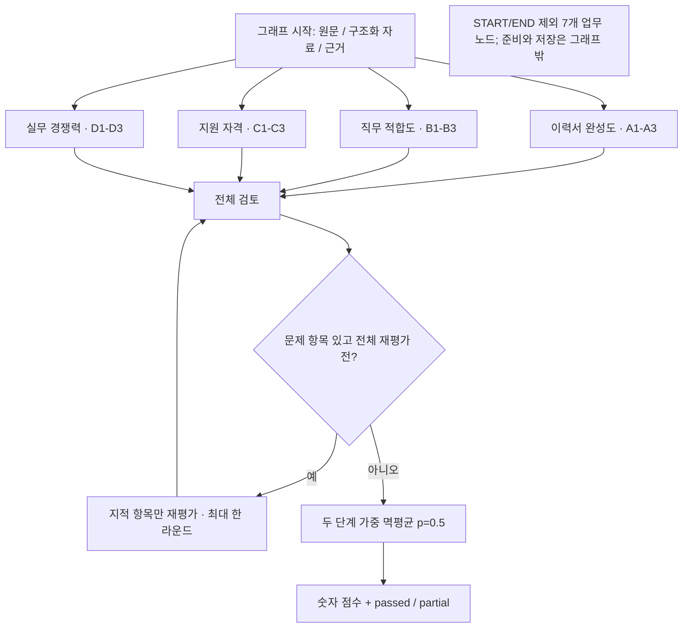
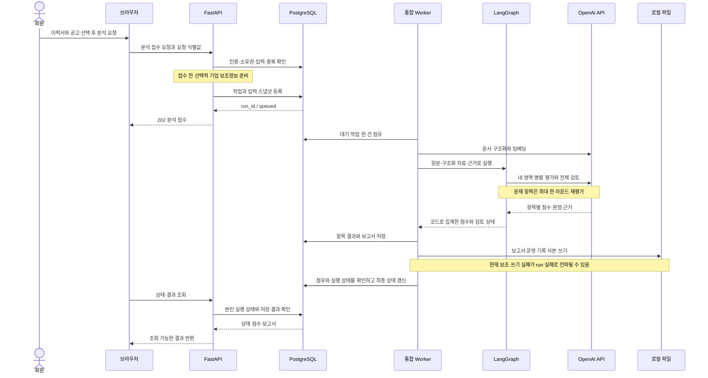

# CareerLens 아키텍처

CareerLens는 이력서와 선택한 모의 채용공고를 비교해, 평가 이유·원문 근거·보완 방향을 보고서로 제공하는 서비스입니다. 이 문서는 현재 팀 배포의 구성과 분석 처리 흐름을 설명합니다.

구현 기준: 2026-10-14 / `caccadedbeb102dd94cdd8bd42ae029f60f4f957`. 문서 갱신일: 2026-10-15.

## 1. 구조 선택

실행 순서를 코드가 정하는 LangGraph 워크플로를 사용합니다. 문서 준비와 저장은 순차로 연결하고, 네 평가 영역은 병렬 실행합니다. 전체 검토가 문제 항목을 지적하면 해당 항목만 최대 한 라운드 재평가합니다. 독립 권한을 가진 자율 에이전트나 Supervisor가 다음 담당을 선택하는 구조는 아닙니다.

## 2. 전체 구성도

FastAPI가 API를 먼저 제공하고 Flask 화면 앱을 WSGI로 마운트합니다. 앱의 lifespan에서 PostgreSQL 연결과 분석 Worker를 시작합니다. 화면·API·Worker는 같은 Uvicorn 프로세스에 있으며 DB는 별도 Render 리소스입니다. 회원 자료 접근은 API에서 인증과 소유권을 확인합니다.

## 3. 평가 구성과 패턴

| 구성 | 책임 |
| --- | --- |
| 문서 준비 | 원문 구조화·청크 분리·임베딩·관련 근거 준비. 그래프 실행 전 처리 |
| 이력서 완성도 | 경험 설명·성과 근거·구성과 가독성의 세 항목 평가 |
| 직무 적합도 | 핵심 기술·담당 업무·우대 역량의 세 항목 평가 |
| 지원 자격 충족도 | 관련 경력·학력/전공·기타 필수조건의 세 항목 평가 |
| 실무 경쟁력 | 업무 규모/난도·문제 해결·역할/책임의 세 항목 평가 |
| 전체 검토 | 항목 누락·근거 충돌·과도한 해석 확인 |
| 문제 항목 재평가 | 전체 검토가 지적한 항목만 재평가 |
| 점수 계산 | 코드로 가중 멱평균을 두 단계 적용 |
| 보고서 저장 | 항목 결과·Markdown 보고서·운영 기록 저장. 그래프 종료 후 처리 |

평가 네 영역과 검토·재평가·계산을 합쳐 7개 업무 노드입니다. 기본 Worker의 분석 건 처리는 순차이며, 한 분석 안의 영역과 항목이 병렬입니다. 외부 모델·임베딩 요청은 기본 네 개의 공유 동시성 제한을 사용합니다.

평가 흐름 Mermaid 원문

## 4. 실행 흐름

분석 도중 사용자 승인을 기다리는 단계는 없습니다. 사용자가 분석을 요청하면 정해진 흐름으로 처리하고, 상태와 결과를 조회합니다.

## 5. 공유 State와 병합

| 필드 | 내용 |
| --- | --- |
| `run_id`, `as_of` | 분석 식별자와 경력 계산 기준일 |
| `resume`, `job` | 구조화한 이력서와 공고 |
| `resume_text`, `job_text` | 선택 당시 원문 |
| `finance`, `chunks` | 기업 보조정보와 관련 근거 |
| `results` | 항목 코드별 최신 결과. 병렬 출력은 reducer로 병합 |
| `affected`, `rechecks` | 전체 검토가 지적한 항목과 재평가 횟수 |
| `scores`, `issues` | 집계 결과와 검토 주의사항 |

재평가한 항목만 새 결과로 교체합니다. State는 13개 키를 선언하며 모든 키를 필수로 요구하지 않습니다.

## 6. 메모리와 데이터 소유

분석 중 정보는 State에, 선택 입력의 고정 사본과 결과·보고서는 PostgreSQL에 보관합니다. 체크포인트는 같은 DB의 별도 스키마에서 관리합니다. 저장 보고서 재조회는 지원하지만 사용자의 취향을 장기간 학습하는 메모리는 없습니다.

관련 근거 검색은 선택 이력서와 원문 해시에 연결됩니다. 검색한 문장과 함께 전체 이력서·공고 원문 및 구조화 자료도 모델에 전달하므로 검색이 원문을 자동 요약·대체하는 것은 아닙니다. 로컬 파일은 사본이며 회원 보고서 조회의 기준은 DB 저장본입니다.

## 7. 도구와 접근 경계

| 기능 | 현재 접근과 제어 |
| --- | --- |
| 문서 구조화·항목 평가·검토 | 서버가 정해진 단계에서 OpenAI API 호출. 응답 형식·범위·인용 확인 |
| 관련 근거 검색 | Python 코드가 선택 이력서의 키워드 문맥·벡터 검색 호출 |
| 자격 조건 계산 | 계산 가능한 조건은 코드로 판단하고 의미 해석이 필요한 조건은 LLM 평가 |
| 기업 보조정보 | 접수 전 선택적으로 조회. 캐시 자료형 처리 오류는 보완 대상 |
| 작업·결과 조회 | JWT 인증과 소유 사용자 확인 |
| 비회원 경로 | 팀 통합 구성에서 공고 탐색까지 제공. 실분석 비활성 |

외부 도구와 다음 실행 순서는 코드가 선택합니다. 모델에 도구 선택을 위임하는 Function Calling은 구현되어 있지 않습니다. 원문 인용 검사는 이력서의 경력 사실 자체를 외부에서 인증하는 기능이 아닙니다.

## 8. 종료와 실패 처리

전체 검토 후 문제 항목이 없거나 재평가 한 라운드가 끝나면 점수를 계산합니다. 한계가 남으면 숫자 점수와 함께 검토 상태 `partial`을 표시합니다. 항목 자체 보완·독립 평가·통신 재시도는 전체 재평가 한도와 별도로 적용됩니다.

LLM 통신 기본 제한은 90초와 SDK 재시도 1회이며 Worker 실행 제한은 기본 900초입니다. 실패·시간 초과·사용자 취소를 완료와 구분합니다. 작업 점유와 최종 상태는 보호하지만 취소가 이미 전송된 외부 요청의 비용을 즉시 중단한다는 뜻은 아닙니다.

현재 DB 결과·보고서 저장 뒤 로컬 사본·운영 기록 쓰기 실패가 실행 실패로 전파될 수 있습니다. 결과 확정과 부가 기록의 실패 경계를 분리해야 합니다. 신규 DB 초기화와 기업정보 캐시의 날짜 처리에서도 재현된 오류를 수정할 필요가 있습니다.

## 9. 관측과 비용

단계·노드·시간·모델 응답 사용량 등 수집된 기록을 DB와 본인 실행 대시보드에 연결합니다. 기록하지 않은 값은 추정해 표시하지 않습니다. 임베딩 사용량과 SDK 내부 재시도의 청구 비용을 포함한 완전한 집계는 아직 없습니다.

이력서 기본 입력 제한은 20,000토큰, 개별 모델 출력 제한은 8,000토큰입니다. 분석 전체 또는 일일 합산 토큰·금액을 차단하는 예산 정책은 미구현입니다. 호출 수는 조건부 평가·검토·재시도에 따라 달라지므로 고정된 평균 비용을 제시하지 않습니다.

## 10. 설계 결정 기록

현재 코드의 선택 근거는 고정된 분석 목적, 독립 평가의 병렬화, 기존 Flask 화면의 통합 재사용입니다. ADR 문서는 아직 저장소에 등록된 승인 기록이 아니며, 다음 항목을 구분해 기록할 수 있습니다.

- ADR-001: 통합 프로세스와 LangGraph 워크플로의 현행 구성
- ADR-002: 결과·보고서·실행 상태의 완료 경계 개선
- ADR-003: 점수 정책과 테스트 기대값 일치
- ADR-004: 전체 분석 비용 상한과 복구 설정 정책

## 11. 검증 범위

2026-10-14 스냅샷에서 공개 배포 OpenAPI와 코드 생성 명세가 일치했습니다. JS 테스트 228개가 통과했고, 실행한 백엔드 선택 테스트는 28개 통과·3개 실패였으며 전체 수집에는 별도 scoring import 오류 1개가 있었습니다. 실제 유료 모델의 분석 품질·운영 DB의 초기화 및 장애 복구·다중 사용자 부하까지 검증한 결과는 아닙니다.

## 12. 배포 구성도

| 항목 | 현재 팀 구성 |
| --- | --- |
| 배포 정의 | `blueprints/team3.yaml` |
| 웹 / DB | `agentservice-team3` / `agent-db-team3` |
| 웹 실행 | `uvicorn app.main:app --host 0.0.0.0 --port $PORT` |
| 인증 | 자체 계정·JWT와 API 소유권 확인 |
| 저장 | Render PostgreSQL + pgvector, 체크포인트 전용 스키마 |
| 상태 확인 | `/healthz`: 웹 프로세스 생존, `/health`: DB 연결 |
| 외부 서비스 | OpenAI API, 선택적 Yahoo Finance |

별도 Worker 서비스·Redis·AWS S3는 현재 팀 Blueprint에 선언되어 있지 않습니다. 상태 확인 성공만으로 외부 모델·Worker·체크포인트 전체의 준비 완료를 보장하지 않습니다.

## 도해 수정용 원문

SVG는 README 표시용이며, 연결 구조는 다음 Mermaid 원문에서도 확인하고 수정할 수 있습니다.

- [전체 구성](diagrams/system.mmd)
- [평가 흐름](diagrams/evaluation.mmd)
- [실행 순서](diagrams/execution.mmd)
- [배포 구성](diagrams/deployment.mmd)

## 구현 근거

- [통합 프로세스와 라우팅](https://github.com/encore-ai-campus/aio-02-p2-team3/blob/caccadedbeb102dd94cdd8bd42ae029f60f4f957/app/main.py)
- [Worker의 작업 점유와 실행](https://github.com/encore-ai-campus/aio-02-p2-team3/blob/caccadedbeb102dd94cdd8bd42ae029f60f4f957/workers/evaluation.py)
- [문서 준비와 최종 저장](https://github.com/encore-ai-campus/aio-02-p2-team3/blob/caccadedbeb102dd94cdd8bd42ae029f60f4f957/app/application/evaluation.py)
- [공유 State와 평가 그래프](https://github.com/encore-ai-campus/aio-02-p2-team3/blob/caccadedbeb102dd94cdd8bd42ae029f60f4f957/app/agent/graphs/matching.py)
- [팀 Render Blueprint](https://github.com/encore-ai-campus/aio-02-p2-team3/blob/caccadedbeb102dd94cdd8bd42ae029f60f4f957/blueprints/team3.yaml)
