# CareerLens 페이지별 화면 안내

2026-10-15 팀 서비스 `https://agentservice-team3.onrender.com/`에서 직접 캡처한 화면입니다. 개인 프로젝트 화면이나 개인 배포의 UI는 사용하지 않았습니다. 설명 번호는 화면 안내를 위해 추가했습니다.

회원 분석은 공개 가상 이력서 CV-006과 교육용 모의공고를 사용했습니다. 진행 화면 확보를 위해 실제 분석 한 건을 실행했으며, 결과는 로그인한 계정에 저장되었습니다. 로그인·회원가입 입력 영역은 가렸습니다.

이용 흐름 캡처는 내장 시연 모드입니다. 화면의 시간·로그·진행률은 가상 값이며 실제 서버 지표나 비활성 기능의 운영 증거로 사용하지 않습니다. 페이지가 길면 해당 기능이 보이는 영역을 스크롤해 캡처했습니다.

아래 22장은 주요 페이지와 세부 상태를 함께 담은 화면 안내입니다. 화면마다 캡처 시점과 선택한 기록이 달라 실행 건수·시각·선택 보고서는 서로 다를 수 있습니다.

[README로 돌아가기](../README.md)

## 01. 소개 화면

경로: `#/intro` · 비회원 · 실제 팀 화면

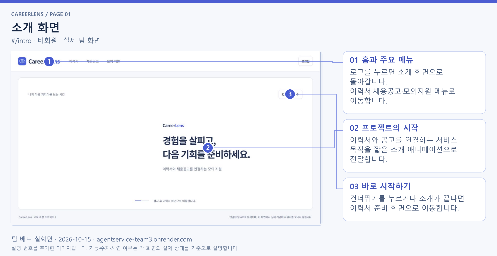

- **홈과 주요 메뉴:** 로고를 누르면 소개 화면으로 돌아갑니다. 이력서·채용공고·모의지원 메뉴로 이동합니다.
- **프로젝트의 시작:** 이력서와 공고를 연결하는 서비스 목적을 짧은 소개 애니메이션으로 전달합니다.
- **바로 시작하기:** 건너뛰기를 누르거나 소개가 끝나면 이력서 준비 화면으로 이동합니다.

## 02. 이메일 로그인

경로: `#/email` · 비회원 · 입력값 가림

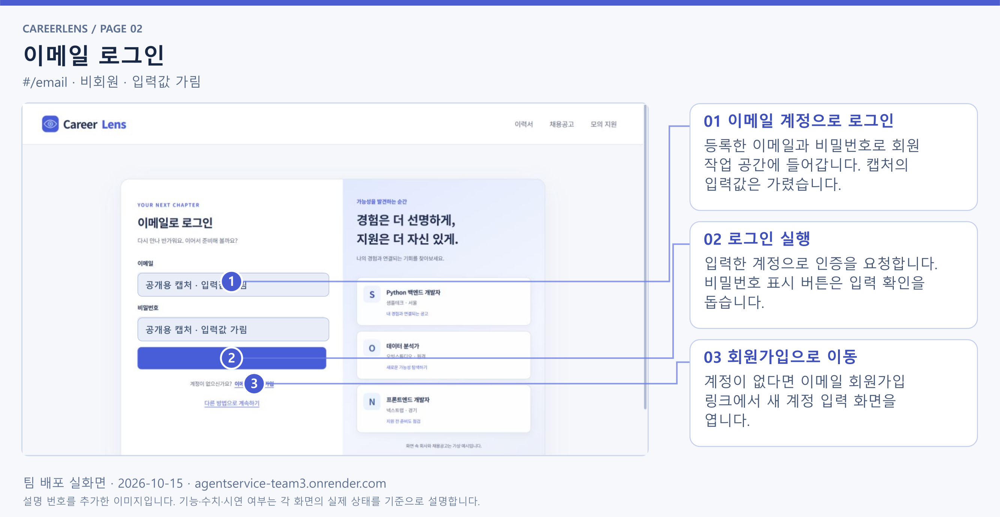

- **이메일 계정으로 로그인:** 등록한 이메일과 비밀번호로 회원 작업 공간에 들어갑니다. 캡처의 입력값은 가렸습니다.
- **로그인 실행:** 입력한 계정으로 인증을 요청합니다. 비밀번호 표시 버튼은 입력 확인을 돕습니다.
- **회원가입으로 이동:** 계정이 없다면 이메일 회원가입 링크에서 새 계정 입력 화면을 엽니다.

## 03. 이메일 회원가입

경로: `#/signup` · 비회원 · 입력값 가림

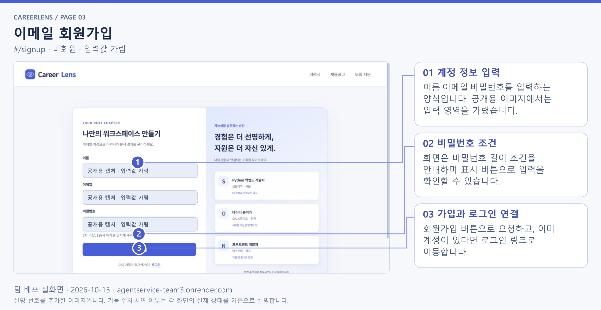

- **계정 정보 입력:** 이름·이메일·비밀번호를 입력하는 양식입니다. 공개용 이미지에서는 입력 영역을 가렸습니다.
- **비밀번호 조건:** 화면은 비밀번호 길이 조건을 안내하며 표시 버튼으로 입력을 확인할 수 있습니다.
- **가입과 로그인 연결:** 회원가입 버튼으로 요청하고, 이미 계정이 있다면 로그인 링크로 이동합니다.

## 04. 회원 이력서 준비

경로: `#/resume` · 회원 · 준비 화면

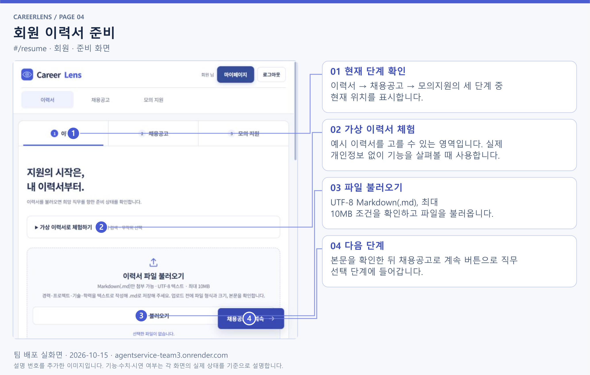

- **현재 단계 확인:** 이력서 → 채용공고 → 모의지원의 세 단계 중 현재 위치를 표시합니다.
- **가상 이력서 체험:** 예시 이력서를 고를 수 있는 영역입니다. 실제 개인정보 없이 기능을 살펴볼 때 사용합니다.
- **파일 불러오기:** UTF-8 Markdown(.md), 최대 10MB 조건을 확인하고 파일을 불러옵니다.
- **다음 단계:** 본문을 확인한 뒤 채용공고로 계속 버튼으로 직무 선택 단계에 들어갑니다.

## 05. 이력서 본문 확인과 편집

경로: `#/resume` · 회원 · 공개 가상 이력서 CV-006

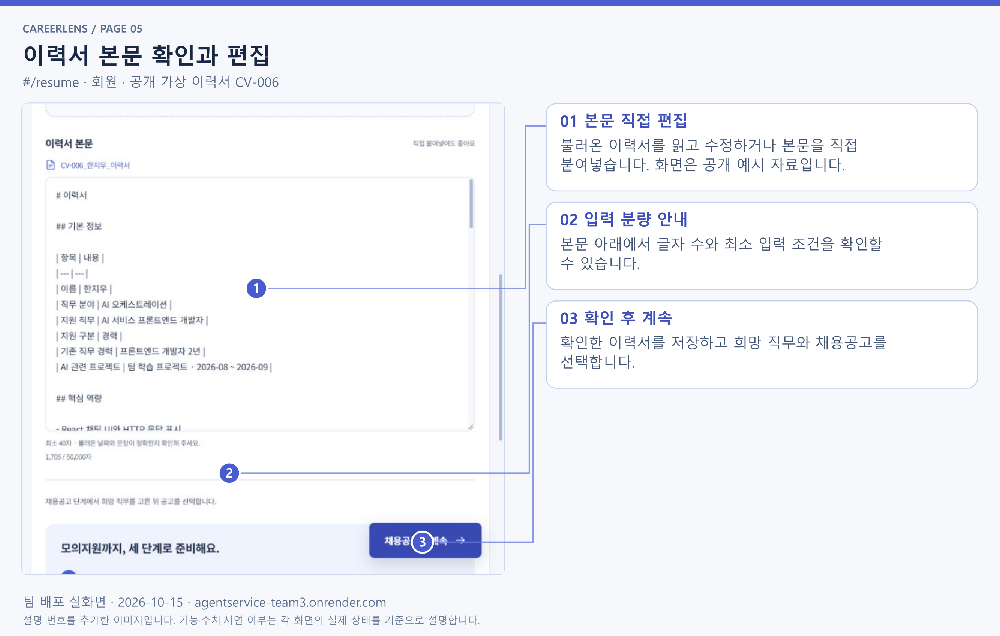

- **본문 직접 편집:** 불러온 이력서를 읽고 수정하거나 본문을 직접 붙여넣습니다. 화면은 공개 예시 자료입니다.
- **입력 분량 안내:** 본문 아래에서 글자 수와 최소 입력 조건을 확인할 수 있습니다.
- **확인 후 계속:** 확인한 이력서를 저장하고 희망 직무와 채용공고를 선택합니다.

## 06. 희망 직무 선택

경로: `#/desired-role` · 비회원 · 공고 탐색

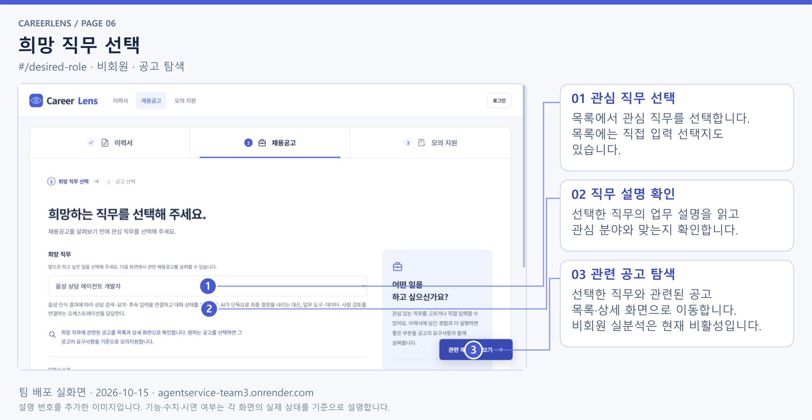

- **관심 직무 선택:** 목록에서 관심 직무를 선택합니다. 목록에는 직접 입력 선택지도 있습니다.
- **직무 설명 확인:** 선택한 직무의 업무 설명을 읽고 관심 분야와 맞는지 확인합니다.
- **관련 공고 탐색:** 선택한 직무와 관련된 공고 목록·상세 화면으로 이동합니다. 비회원 실분석은 현재 비활성입니다.

## 07. 채용공고 목록과 표시 범위

경로: `#/opportunities` · 비회원 · 교육용 가상 공고

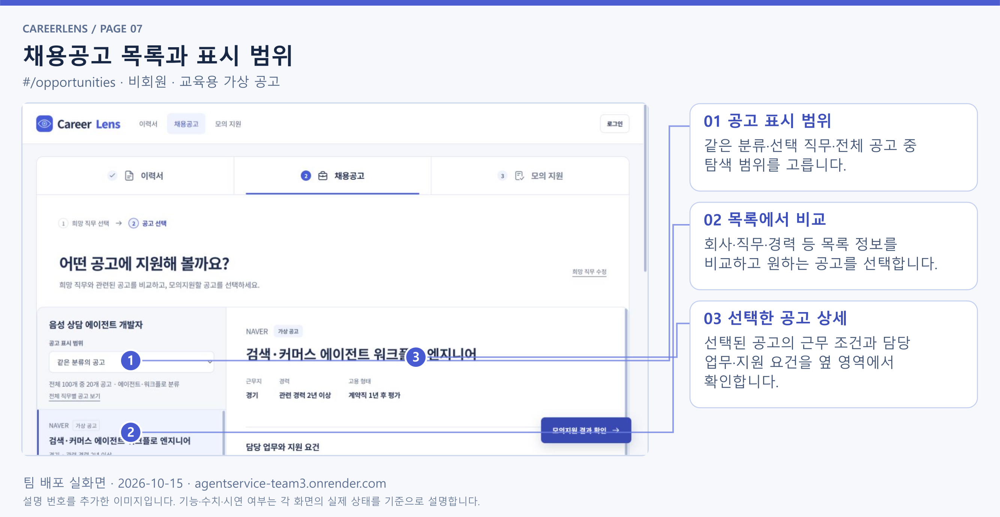

- **공고 표시 범위:** 같은 분류·선택 직무·전체 공고 중 탐색 범위를 고릅니다.
- **목록에서 비교:** 회사·직무·경력 등 목록 정보를 비교하고 원하는 공고를 선택합니다.
- **선택한 공고 상세:** 선택된 공고의 근무 조건과 담당 업무·지원 요건을 옆 영역에서 확인합니다.

## 08. 공고 상세와 모의지원 진입

경로: `#/opportunities` · 비회원 · 교육용 가상 공고

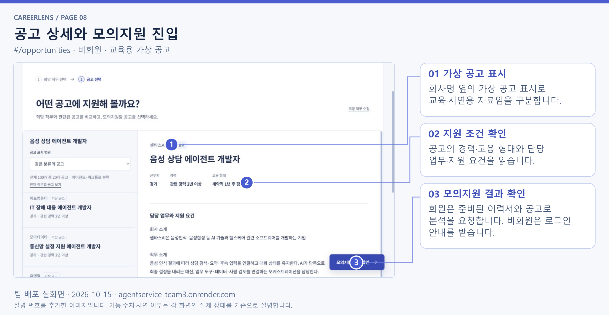

- **가상 공고 표시:** 회사명 옆의 가상 공고 표시로 교육·시연용 자료임을 구분합니다.
- **지원 조건 확인:** 공고의 경력·고용 형태와 담당 업무·지원 요건을 읽습니다.
- **모의지원 결과 확인:** 회원은 준비된 이력서와 공고로 분석을 요청합니다. 비회원은 로그인 안내를 받습니다.

## 09. 실제 분석 진행 화면

경로: `분석 중 표시` · 회원 · 가상 이력서로 실제 분석 1회

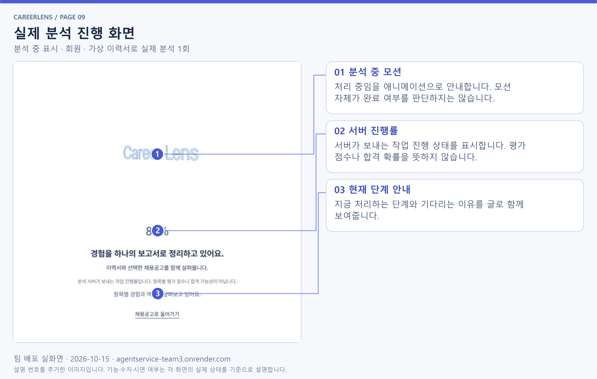

- **분석 중 모션:** 처리 중임을 애니메이션으로 안내합니다. 모션 자체가 완료 여부를 판단하지는 않습니다.
- **서버 진행률:** 서버가 보내는 작업 진행 상태를 표시합니다. 평가 점수나 합격 확률을 뜻하지 않습니다.
- **현재 단계 안내:** 지금 처리하는 단계와 기다리는 이유를 글로 함께 보여줍니다.

## 10. 분석 보고서와 네 평가축

경로: `#/result` · 회원 · 실제 저장된 분석 결과

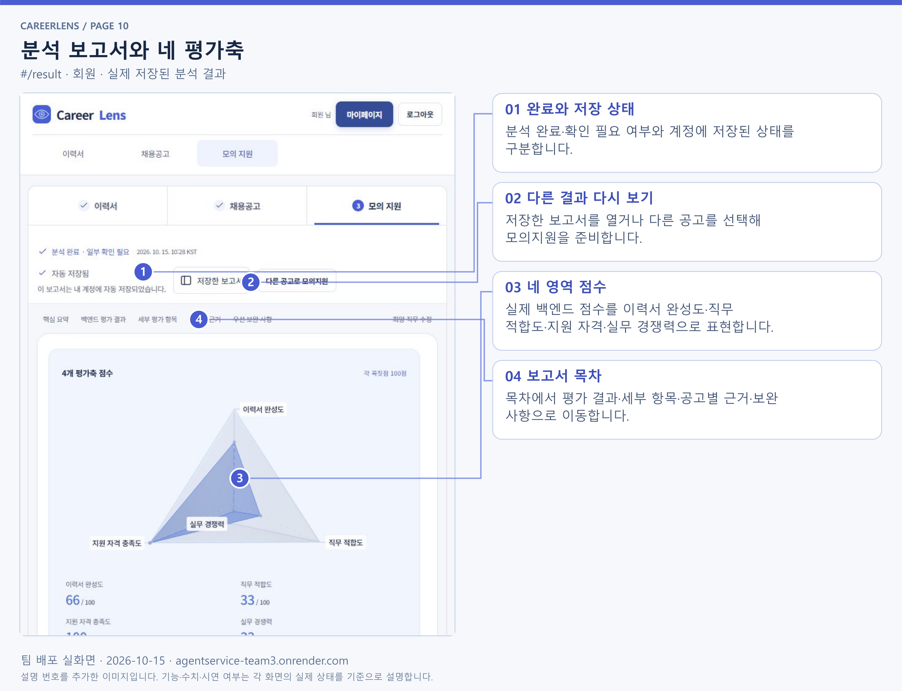

- **완료와 저장 상태:** 분석 완료·확인 필요 여부와 계정에 저장된 상태를 구분합니다.
- **다른 결과 다시 보기:** 저장한 보고서를 열거나 다른 공고를 선택해 모의지원을 준비합니다.
- **네 영역 점수:** 실제 백엔드 점수를 이력서 완성도·직무 적합도·지원 자격·실무 경쟁력으로 표현합니다.
- **보고서 목차:** 목차에서 평가 결과·세부 항목·공고별 근거·보완 사항으로 이동합니다.

## 11. 판정 상태와 세부 평가 읽기

경로: `#/result` · 회원 · 실제 저장된 분석 결과

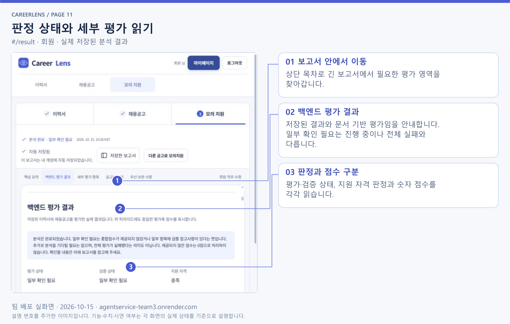

- **보고서 안에서 이동:** 상단 목차로 긴 보고서에서 필요한 평가 영역을 찾아갑니다.
- **백엔드 평가 결과:** 저장된 결과와 문서 기반 평가임을 안내합니다. 일부 확인 필요는 진행 중이나 전체 실패와 다릅니다.
- **판정과 점수 구분:** 평가·검증 상태, 지원 자격 판정과 숫자 점수를 각각 읽습니다.

## 12. 저장한 보고서 사이드바

경로: `#/result → 저장한 보고서` · 회원 · 저장 보고서 재조회

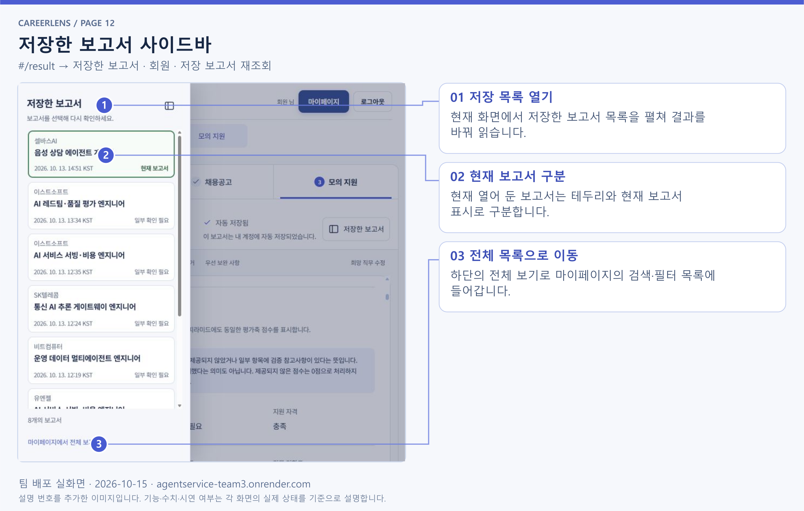

- **저장 목록 열기:** 현재 화면에서 저장한 보고서 목록을 펼쳐 결과를 바꿔 읽습니다.
- **현재 보고서 구분:** 현재 열어 둔 보고서는 테두리와 현재 보고서 표시로 구분합니다.
- **전체 목록으로 이동:** 하단의 전체 보기로 마이페이지의 검색·필터 목록에 들어갑니다.

## 13. 마이페이지

경로: `#/mypage` · 회원 · 본인 계정과 기록

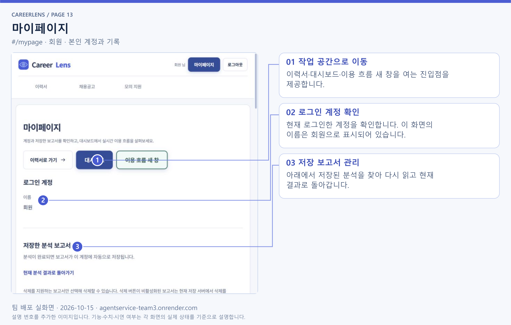

- **작업 공간으로 이동:** 이력서·대시보드·이용 흐름 새 창을 여는 진입점을 제공합니다.
- **로그인 계정 확인:** 현재 로그인한 계정을 확인합니다. 이 화면의 이름은 회원으로 표시되어 있습니다.
- **저장 보고서 관리:** 아래에서 저장된 분석을 찾아 다시 읽고 현재 결과로 돌아갑니다.

## 14. 저장 보고서 검색과 필터

경로: `#/mypage` · 회원 · 불러온 보고서 범위

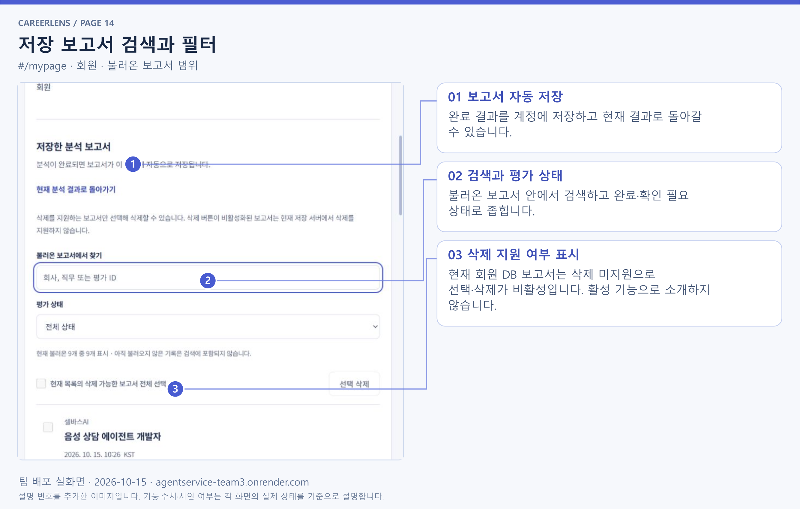

- **보고서 자동 저장:** 완료 결과를 계정에 저장하고 현재 결과로 돌아갈 수 있습니다.
- **검색과 평가 상태:** 불러온 보고서 안에서 검색하고 완료·확인 필요 상태로 좁힙니다.
- **삭제 지원 여부 표시:** 현재 회원 DB 보고서는 삭제 미지원으로 선택·삭제가 비활성입니다. 활성 기능으로 소개하지 않습니다.

## 15. 저장 보고서 카드 목록

경로: `#/mypage` · 회원 · 실제 저장 목록

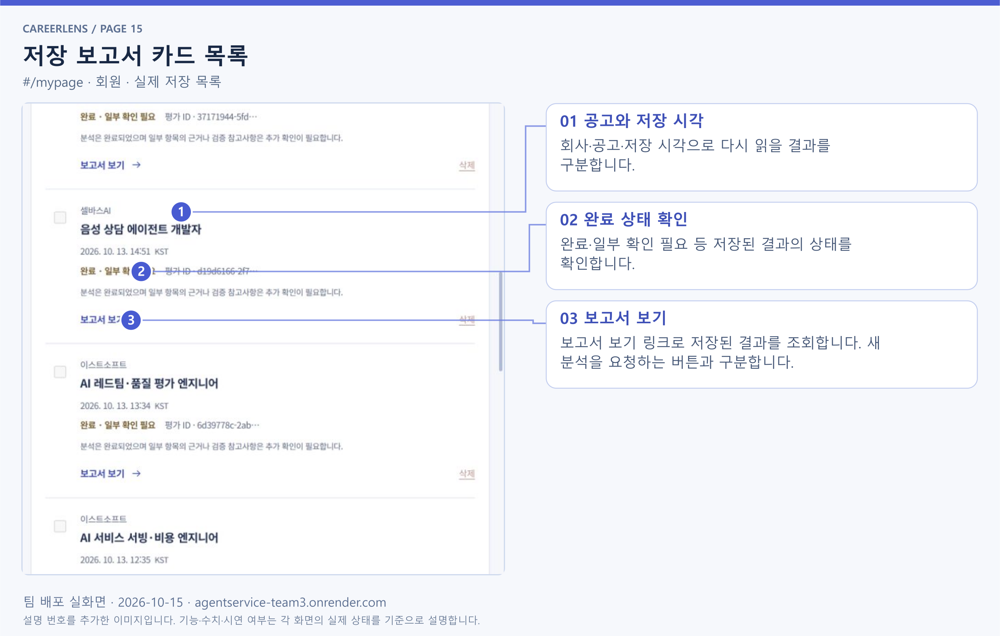

- **공고와 저장 시각:** 회사·공고·저장 시각으로 다시 읽을 결과를 구분합니다.
- **완료 상태 확인:** 완료·일부 확인 필요 등 저장된 결과의 상태를 확인합니다.
- **보고서 보기:** 보고서 보기 링크로 저장된 결과를 조회합니다. 새 분석을 요청하는 버튼과 구분합니다.

## 16. 본인 실행 대시보드

경로: `#/admin` · 회원 · 현재 계정의 실행 기록

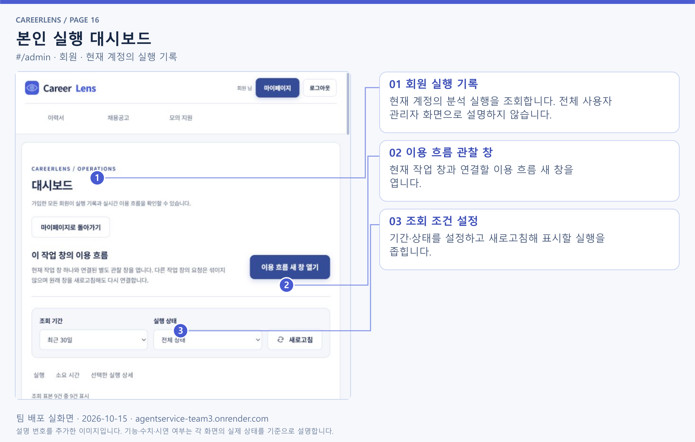

- **회원 실행 기록:** 현재 계정의 분석 실행을 조회합니다. 전체 사용자 관리자 화면으로 설명하지 않습니다.
- **이용 흐름 관찰 창:** 현재 작업 창과 연결할 이용 흐름 새 창을 엽니다.
- **조회 조건 설정:** 기간·상태를 설정하고 새로고침해 표시할 실행을 좁힙니다.

## 17. 실행 목록과 처리 시간

경로: `#/admin` · 회원 · 조회 표본의 실제 기록

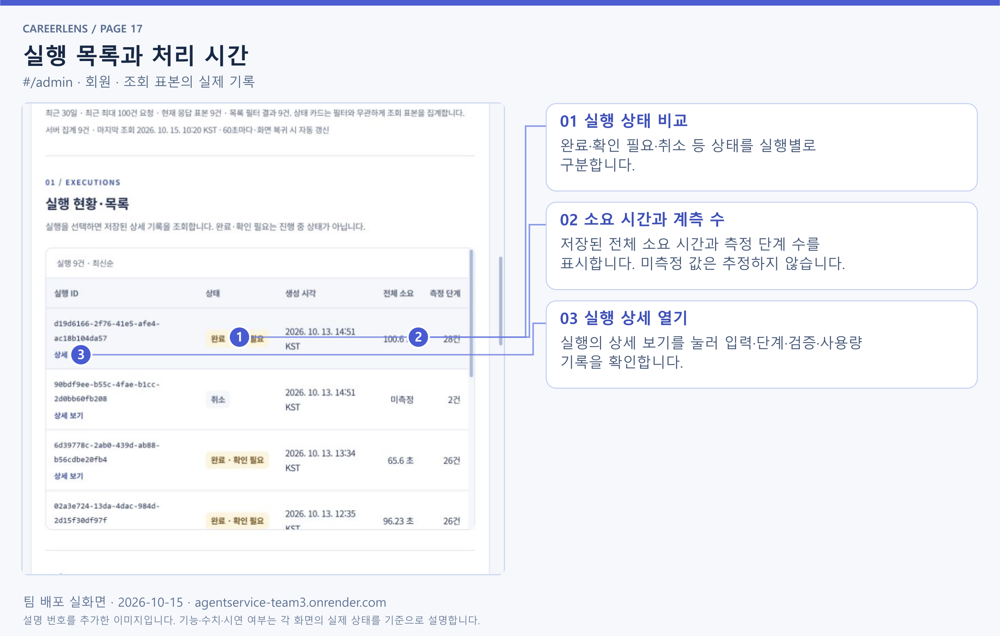

- **실행 상태 비교:** 완료·확인 필요·취소 등 상태를 실행별로 구분합니다.
- **소요 시간과 계측 수:** 저장된 전체 소요 시간과 측정 단계 수를 표시합니다. 미측정 값은 추정하지 않습니다.
- **실행 상세 열기:** 실행의 상세 보기를 눌러 입력·단계·검증·사용량 기록을 확인합니다.

## 18. 선택한 실행의 상세 기록

경로: `#/admin → 실행 상세` · 회원 · 저장된 추적 정보

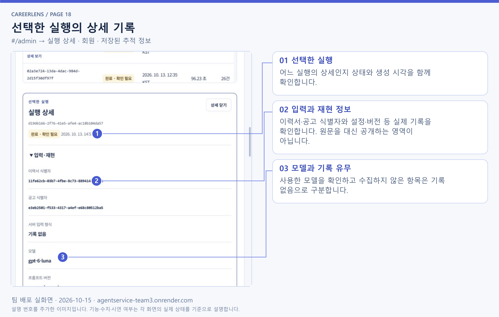

- **선택한 실행:** 어느 실행의 상세인지 상태와 생성 시각을 함께 확인합니다.
- **입력과 재현 정보:** 이력서·공고 식별자와 설정·버전 등 실제 기록을 확인합니다. 원문을 대신 공개하는 영역이 아닙니다.
- **모델과 기록 유무:** 사용한 모델을 확인하고 수집하지 않은 항목은 기록 없음으로 구분합니다.

## 19. 이용 흐름의 모드와 시연 선택

경로: `/?view=flow` · 내장 시연 모드 · 실제 요청 실행 없음

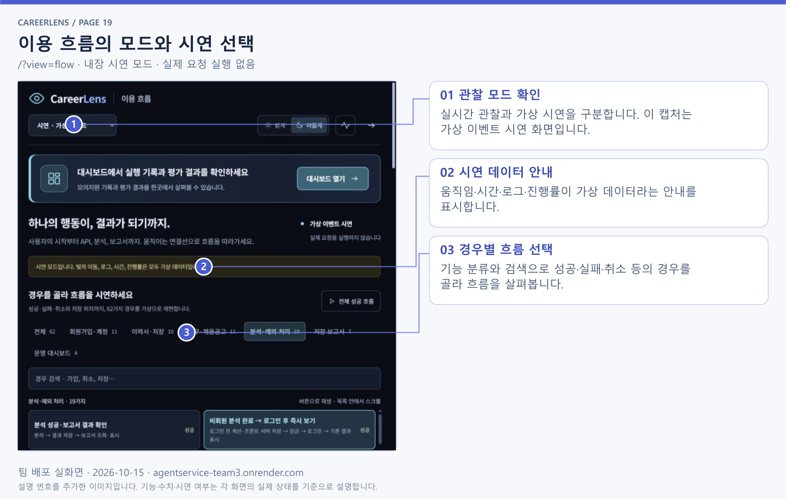

- **관찰 모드 확인:** 실시간 관찰과 가상 시연을 구분합니다. 이 캡처는 가상 이벤트 시연 화면입니다.
- **시연 데이터 안내:** 움직임·시간·로그·진행률이 가상 데이터라는 안내를 표시합니다.
- **경우별 흐름 선택:** 기능 분류와 검색으로 성공·실패·취소 등의 경우를 골라 흐름을 살펴봅니다.

## 20. 이용 흐름 지도와 단계 상태

경로: `/?view=flow → 시연 지도` · 내장 시연 완료 화면 · 가상 이벤트

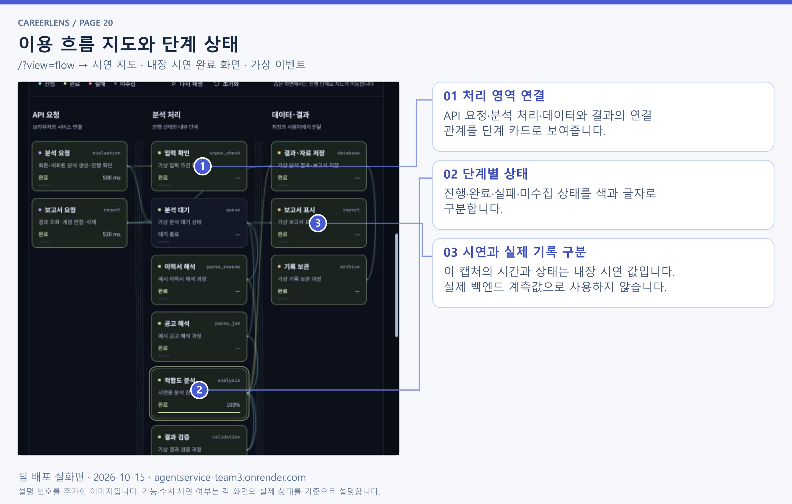

- **처리 영역 연결:** API 요청·분석 처리·데이터와 결과의 연결 관계를 단계 카드로 보여줍니다.
- **단계별 상태:** 진행·완료·실패·미수집 상태를 색과 글자로 구분합니다.
- **시연과 실제 기록 구분:** 이 캡처의 시간과 상태는 내장 시연 값입니다. 실제 백엔드 계측값으로 사용하지 않습니다.

## 21. 이벤트 로그와 응답 시간

경로: `/?view=flow → 기록·상세` · 내장 시연 모드 · 가상 시간

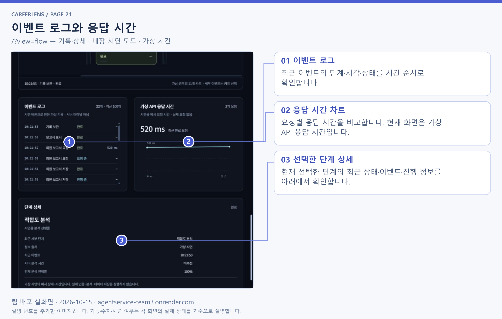

- **이벤트 로그:** 최근 이벤트의 단계·시각·상태를 시간 순서로 확인합니다.
- **응답 시간 차트:** 요청별 응답 시간을 비교합니다. 현재 화면은 가상 API 응답 시간입니다.
- **선택한 단계 상세:** 현재 선택한 단계의 최근 상태·이벤트·진행 정보를 아래에서 확인합니다.

## 22. 비회원 이력서 준비와 현재 제한

경로: `#/resume` · 비회원 · 실제 팀 화면

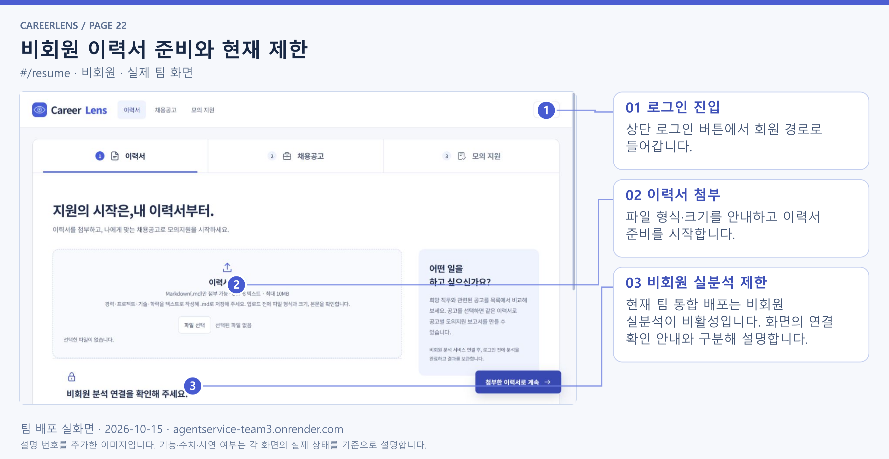

- **로그인 진입:** 상단 로그인 버튼에서 회원 경로로 들어갑니다.
- **이력서 첨부:** 파일 형식·크기를 안내하고 이력서 준비를 시작합니다.
- **비회원 실분석 제한:** 현재 팀 통합 배포는 비회원 실분석이 비활성입니다. 화면의 연결 확인 안내와 구분해 설명합니다.
